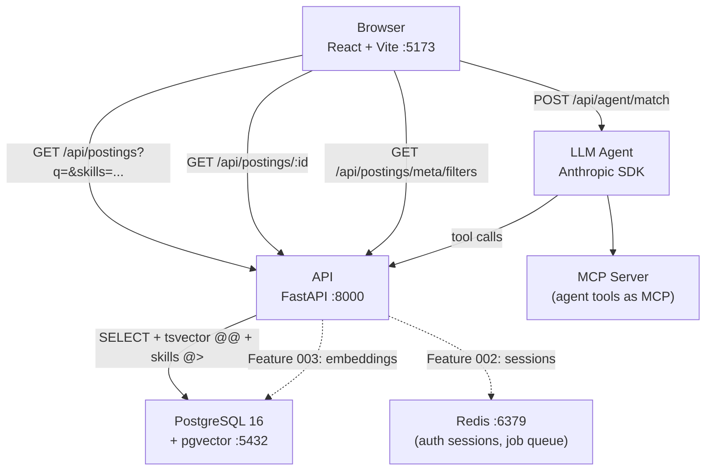

# CoopRadar

A full-stack app that aggregates co-op and internship postings, lets students browse, search, and filter them in one place, and uses an LLM agent to match a resume against postings and explain skill gaps.

---

## Why

Students checking Waterloo's WaterlooWorks, LinkedIn, Glassdoor, and company career pages manually waste hours per cycle. CoopRadar centralizes postings, exposes fast full-text + skills search, and eventually adds an AI layer that reads your resume and tells you exactly what you're missing.

---

## Architecture



---

## Stack

| Layer | Technology |
|-------|-----------|
| Backend API | Python 3.12, FastAPI 0.115+, Pydantic v2, SQLAlchemy 2.0 async |
| Database | PostgreSQL 16 + pgvector |
| Migrations | Alembic |
| Jobs | RQ + Redis (Feature 002+) |
| Frontend | React 18, TypeScript 5, Vite 6 |
| Data tables | TanStack Table v8 (manual server-side mode) |
| Data fetching | TanStack Query v5 |
| Styling | Tailwind CSS v3 (mobile-first) |
| URL state | React Router v6 `useSearchParams` |
| AI Agent | Anthropic Python SDK with tool use |
| MCP Server | Same agent tools exposed as MCP |
| Tests | pytest + pytest-asyncio (backend), Vitest + Testing Library (frontend) |
| Lint / types | ruff, mypy --strict (backend); eslint, tsc --noEmit (frontend) |
| CI | GitHub Actions |
| Local infra | Docker Compose |

---

## Project Structure

```
COOP-Radar/
├── docker-compose.yml
├── .env.example
├── README.md
├── .github/
│   └── workflows/
│       └── ci.yml
├── backend/
│   ├── Dockerfile
│   ├── pyproject.toml
│   ├── alembic.ini
│   ├── alembic/
│   │   ├── env.py
│   │   └── versions/
│   │       └── 0001_create_postings.py
│   ├── app/
│   │   ├── main.py
│   │   ├── config.py
│   │   ├── db.py
│   │   ├── models/
│   │   │   └── posting.py
│   │   ├── schemas/
│   │   │   └── posting.py
│   │   ├── services/
│   │   │   └── postings.py
│   │   └── api/
│   │       └── postings.py
│   ├── seed/
│   │   └── __init__.py
│   └── tests/
│       ├── conftest.py
│       ├── api/
│       │   └── test_postings.py
│       └── perf/
│           └── test_perf.py
├── frontend/
│   ├── Dockerfile
│   ├── package.json
│   ├── vite.config.ts
│   ├── tailwind.config.ts
│   ├── tsconfig.json
│   └── src/
│       ├── main.tsx
│       ├── App.tsx
│       ├── api/
│       │   ├── types.gen.ts      (generated — do not edit)
│       │   └── postings.ts
│       ├── components/
│       │   ├── PostingsTable.tsx
│       │   ├── PostingCard.tsx
│       │   ├── FilterBar.tsx
│       │   └── SearchBox.tsx
│       └── pages/
│           ├── PostingsListPage.tsx
│           └── PostingDetailPage.tsx
├── docs/
│   └── agentic-workflow.md
└── coopradar/                    (spec-kit workspace — see below)
    └── specs/
        └── 001-browse-search-postings/
            ├── spec.md
            ├── plan.md
            ├── data-model.md
            ├── research.md
            ├── contracts/api.md
            ├── quickstart.md
            ├── tasks.md
            └── checklists/
```

---

## Milestones

### Feature 001 — Browse & Search Postings (current)

A working vertical slice: monorepo scaffold, database schema, seed data, REST API with full-text and skills search, React table with server-side sort/filter/pagination, and URL state. No login required.

**Status**: Spec, plan, data model, API contracts, and task list complete. Ready for implementation.

Key capabilities:
- Paginated postings table (title, company, location, work mode, term, duration, deadline)
- Full-text keyword search via PostgreSQL `tsvector` (title/company/skills weighted above description)
- Filters: city, province, term, work mode, duration (4/8/12/16 mo), skills (AND logic)
- Server-side sort: posted date, deadline, company, title
- "Show expired" toggle
- Posting detail page with full description + source link
- All state in URL (shareable, bookmarkable, survives refresh)
- ~60 realistic seed postings across 8 Canadian cities and 3 co-op terms
- Performance validated: p95 ≤ 300 ms at 10,000 rows

### Feature 002 — Accounts & Application Tracker (planned)

User accounts (argon2 passwords, HTTP-only cookies), personal saved postings list, application status tracker (applied/interviewing/offer/rejected), Redis-backed sessions.

### Feature 003 — Real Postings & Semantic Search (planned)

Public job-board API ingestion (co-op feeds, LinkedIn public search), RQ background jobs, pgvector cosine-similarity semantic search alongside full-text, embedding generation via Anthropic API.

### Feature 004 — AI Resume Matcher & Assistant (planned)

Resume upload + parsing, Anthropic SDK agent with tool use (search_postings, get_posting, score_fit, save_application), fit scoring with skill gap explanation, MCP server exposing the same tools.

---

## Getting Started

### Prerequisites

- Docker Desktop (or Docker Engine + Compose v2)
- Git
- Node 20+ (for running `npm run gen:api` outside Docker)
- Python 3.12+ (for running speckit scripts outside Docker)

### 1. Clone and configure

```bash
git clone https://github.com/<your-org>/COOP-Radar.git
cd COOP-Radar
cp .env.example .env
# Edit .env — set POSTGRES_PASSWORD and any other values you want to change
```

### 2. Start the stack

```bash
docker compose up --build
```

This starts four containers:
- `db` — PostgreSQL 16 with pgvector on port 5432
- `redis` — Redis on port 6379
- `api` — FastAPI on port 8000 (auto-reloads on code changes)
- `web` — Vite dev server on port 5173 (HMR enabled)

### 3. Run the database migration

```bash
docker compose exec api alembic upgrade head
```

### 4. Seed sample data

```bash
docker compose exec api python -m seed
```

### 5. Open the app

Visit `http://localhost:5173` — you should see ~60 co-op postings from across Canada.

API docs (OpenAPI): `http://localhost:8000/docs`

---

## Development Commands

```bash
# Start everything
docker compose up --build

# Backend tests
docker compose exec api pytest -q

# Backend tests (performance only)
docker compose exec api pytest -q -m perf

# Backend lint + type check
docker compose exec api ruff check .
docker compose exec api mypy --strict app

# Frontend tests
docker compose exec web npm run test

# Frontend lint + type check
docker compose exec web npm run lint
docker compose exec web npm run typecheck

# Regenerate frontend API types from FastAPI OpenAPI schema
# (run after any backend schema change)
npm run gen:api --prefix frontend

# New database migration (review before applying)
docker compose exec api alembic revision --autogenerate -m "describe your change"
docker compose exec api alembic upgrade head

# Rollback last migration
docker compose exec api alembic downgrade -1
```

---

## Speckit Workflow (AI-assisted development)

This project uses [spec-kit](https://github.com/github/spec-kit) with the Claude integration for structured AI-assisted feature development. All specs live in `coopradar/specs/`.

The full workflow for each feature:

```
/speckit-specify   → write the feature spec (user stories, requirements, success criteria)
/speckit-clarify   → resolve any ambiguities in the spec
/speckit-plan      → generate research.md, data-model.md, contracts/, quickstart.md
/speckit-checklist → generate a custom quality checklist
/speckit-tasks     → generate tasks.md (actionable, dependency-ordered task list)
/speckit-analyze   → cross-artifact consistency check before implementation
/speckit-implement → execute all tasks from tasks.md
/speckit-converge  → check what's still unbuilt; repeat until converged
/log-agentic-work  → update docs/agentic-workflow.md with session summary
```

To pick up Feature 001 implementation:

```bash
cd coopradar/coopradar
# All spec artifacts are ready:
#   specs/001-browse-search-postings/spec.md       — feature spec
#   specs/001-browse-search-postings/plan.md       — technical plan
#   specs/001-browse-search-postings/data-model.md — DB schema
#   specs/001-browse-search-postings/contracts/api.md — API contracts
#   specs/001-browse-search-postings/tasks.md      — 54 implementation tasks

# Run:
# /speckit-implement
```

---

## Rules (from the project constitution)

The full constitution is at `coopradar/coopradar/.specify/memory/constitution.md`. Key rules:

- All sorting, filtering, and pagination happen in SQL — never in the browser or application memory
- Every endpoint ships with a Pydantic schema and at least one pytest
- Secrets only from env vars — never committed
- No scraping behind logins — public APIs and feeds only
- The AI agent must cite a posting ID for every claim; no guessing
- Conventional commits (`feat:`, `fix:`, `test:`, `chore:`) on feature branches, merged via PR
- CI (ruff, mypy, pytest, eslint, tsc, vitest) must be green before merge

---

## Contributing

1. Create a branch: `git checkout -b NNN-short-description`
2. Follow the speckit workflow above to spec and plan your feature
3. Implement tasks from `tasks.md` in order
4. Ensure all CI checks pass: `pytest -q`, `mypy --strict app`, `ruff check .`, `npm run lint`, `npm run typecheck`, `npm run test`
5. Update `docs/agentic-workflow.md` via `/log-agentic-work`
6. Open a pull request — all gates must be green

---

## License

MIT
