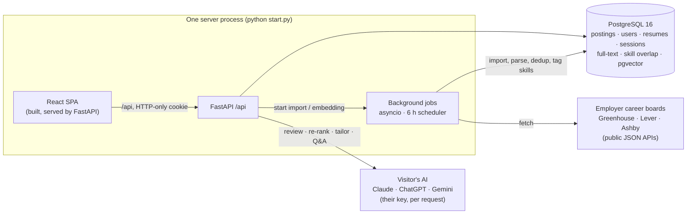

# CoopRadar

**Drop in your resume. See what it's good at, what employers want that it's missing, how to tailor it, and which
real co-op jobs to apply for.** CoopRadar imports live postings from Canadian employers' own career boards, matches
them to a student's resume in SQL for free, and layers on bring-your-own-key AI (Claude, ChatGPT, or Gemini) for
reviews, tailoring plans, and cover letter openers.

[](https://github.com/mbendari7/COOP-Radar/actions/workflows/ci.yml)
[](https://render.com/deploy?repo=https://github.com/mbendari7/COOP-Radar)

**🌐 Live site:** _add your link after deploying_ · **New here or not a developer?** Read the
**[User Guide](docs/USER_GUIDE.md)**: how to use it, run it, put it online, and tips.

```bash
python start.py      # sets everything up the first time, then opens http://localhost:8000
```

---

## What it does

| | |
|---|---|
| 📄 **Resume in, no sign-up** | Drag and drop a PDF or DOCX. A private temporary account is created (kept 7 days). Keep it any time with an email and password. |
| ✅ **What your resume shows** | Skills found on the resume that real postings ask for. Free, computed in SQL. |
| 📈 **What you're missing** | The most-requested skills across open postings that the resume doesn't show, with how many jobs ask for each. |
| 🤖 **AI resume review** | Strengths, fixes, tailoring tips, roles to search, and honest keywords to add. Uses the visitor's own key; cached per resume. |
| 💼 **Jobs to apply for** | Top 20 open jobs ranked for a *student*: skill coverage, senior roles demoted, co-op and intern roles boosted, each with a data-backed reason. Optional AI re-rank. |
| ✏️ **Per-job assistant** | One click for a tailoring plan (what to lead with, bullet rewrites, keywords, gaps) or a cover letter opener, plus cited Q&A. Streams live. |
| 🔎 **Real jobs** | About 800 Canadian postings from 27 employers via public Greenhouse, Lever, and Ashby job-board APIs, refreshed every 6 h. Search, filter (city includes remote), and "Co-op & intern only". |
| 🗂️ **Tracker** | Save jobs, move them through 7 statuses with dated notes, board or table view, deadlines this week, CSV export. |

## How it works



1. **Ingest**: per employer, an adapter fetches the board's JSON, keeps Canadian locations, parses `City, Province`,
   de-duplicates (same company and city with title similarity above 0.85), tags skills with context rules (C, R,
   Go, Spring), and sets an estimated apply-by date when none is published. Vanished jobs are closed; failing
   boards auto-pause.
2. **Resume**: upload creates a guest session if needed. Text is extracted with pypdf or python-docx; the file isn't kept.
3. **Preferences**: job types (inferred from titles with constant regexes, `services/categories.py`), province/city
   (remote always counts), work modes and level become SQL `WHERE` clauses; keywords add +0.3 via `websearch_to_tsquery`.
4. **Free matching (SQL)**: coverage = matched ÷ max(listed skills, 3), then student fit (×0.5 for
   senior/lead/manager titles, +0.25 for co-op/intern/new-grad titles). The top 20 are stored with reasons like
   *"You have Python, SQL; it also asks for Go."*, and each match lists the posting's skills found and missing.
5. **Insights**: skills found, plus in-demand skills missing from `unnest(skills) GROUP BY` over open postings. The
   optional AI review is strict JSON, validated, and cached in `resumes.insights`.
5. **AI (bring your own key)**: the key is kept in the browser and sent as `X-AI-*` headers. `app/ai.py` wraps the
   official Anthropic, OpenAI, and Google GenAI SDKs behind `complete()` and `stream()` with normalized errors.
   Prompts treat documents as data, never invent experience, and require citations or "not enough information".

Full walkthrough and talking points: **[docs/HOW_IT_WORKS.md](docs/HOW_IT_WORKS.md)**.

## Tech stack

| Layer | Technology |
|---|---|
| Backend | Python 3.12, FastAPI, Pydantic v2, SQLAlchemy 2.0 (async, typed `Mapped[]`), asyncpg |
| Database | PostgreSQL 16: generated `tsvector` + GIN (weighted keyword search), array skill matching, JSONB, **pgvector** (optional smart search) |
| Migrations | Alembic `0001`–`0009` (round-trip + `alembic check` in CI) |
| Background jobs | asyncio tasks in the web process with a bounded worker pool and a 6-hourly scheduler (`app/jobs.py`); httpx adapters for Greenhouse / Lever / Ashby, plus JSON API, RSS, and CSV |
| Auth | argon2id, opaque session tokens in a pluggable key-value store (Postgres `kv_store` table by default, **Redis** when `REDIS_URL` is set), HTTP-only Secure cookies, temporary (guest/demo) accounts with claim |
| AI | Bring your own key: `anthropic`, `openai`, `google-genai` SDKs behind one module; streaming SSE; optional owner keys (Claude fallback with a daily limit, OpenAI embeddings) |
| Frontend | React 18, TypeScript 5, Vite 6, TanStack Query v5, TanStack Table v8, React Router v6, Tailwind CSS v3, dnd-kit |
| Testing | pytest + pytest-asyncio (**255**, incl. a 10k-row latency budget), Vitest + Testing Library (**36**) |
| Quality | ruff, mypy `--strict`, eslint, `tsc --noEmit` |
| Delivery | GitHub Actions (lint, types, migrations, tests, then the whole site started with `start.py --hosted` and smoke-tested), Render Blueprint (native Python runtime) |

## Run it

You need **Python 3.12+** and **Node.js 20+**. Nothing else: no Docker, no database to install.

```bash
git clone https://github.com/mbendari7/COOP-Radar.git && cd COOP-Radar
python start.py          # first run takes a few minutes, then → http://localhost:8000
```

The first run creates `backend/.venv`, installs packages (with [uv](https://docs.astral.sh/uv/) if you have it,
otherwise pip), builds the React site, and starts a private PostgreSQL 16 + pgvector in `~/.coopradar` (your home folder) using the
[`pgserver`](https://pypi.org/project/pgserver/) package. Then it migrates, seeds, serves the site and API on one
port, and imports real jobs in the background. To use a cloud database instead, put `DATABASE_URL` in `.env`.

**Online:** click **Deploy to Render** above, then **Apply**. Optional: put Vercel in front for a
`*.vercel.app` address (`vercel.json` serves the pages from Vercel's CDN and forwards `/api` to Render; see
`docs/DEPLOY.md`). Details and free-tier caveats are in
[docs/DEPLOY.md](docs/DEPLOY.md). Real jobs import within minutes of going live.

| Task | Command |
|---|---|
| Develop with live reload | `python start.py --dev` → site :5173 (Vite HMR), API :8000 (docs at `/docs`), API auto-reloads |
| Run as a host does | `python start.py --hosted` (needs `DATABASE_URL`; serves on `$PORT`) |
| Backend lint / types / tests | `cd backend && .venv/Scripts/activate` (Windows) or `source .venv/bin/activate`, `pip install -e ".[dev]"`, then `ruff check . && mypy app && pytest -q -m "not perf"` (tests need `DATABASE_URL` pointing at a throwaway database) |
| Perf budget (p95 on 10k postings) | `pytest -q -m perf -s` |
| Frontend | `cd frontend && npm run lint && npm run typecheck && npm test && npm run build` |
| New migration | `alembic revision --autogenerate -m "…"`, review it, then `alembic upgrade head` (or the `/db-migration` skill) |
| Import jobs now | Admin page → **Run now**, or wait for the scheduler (runs on start, then every `INGEST_INTERVAL_HOURS`) |
| Reset local data | Stop the site and delete the `.coopradar` folder in your home folder |

## Configuration

All settings are environment variables (or a `.env` file), documented in [`.env.example`](.env.example). None are
required on your own computer.

| Variable | Default | Purpose |
|---|---|---|
| `DATABASE_URL` | local database from `start.py` | Postgres (`postgres://` and `?sslmode=` URLs are normalized). Required on a host |
| `REDIS_URL` | empty | Optional: keep sessions and rate limits in Redis instead of the `kv_store` table |
| `DEMO_ENABLED` | `true` | "Try the demo" + upload without an account (temporary accounts, 7 days) |
| `ANTHROPIC_API_KEY` | empty | Optional shared Claude key for visitors without one, capped by `AI_DAILY_LIMIT` (default 20/day) |
| `OPENAI_API_KEY` | empty | Optional: smart (semantic) search, similar postings, embedding shortlist |
| `SEED_JOB_BOARDS` · `SEED_SAMPLE_POSTINGS` · `SEED_DEV_SOURCES` | `true` · `false` · `false` | What the seed loads: real career boards · made-up postings · Admin-page fixtures |
| `BACKGROUND_JOBS` | `true` | Run imports and the scheduler inside the web process |
| `INGEST_INTERVAL_HOURS` · `INGEST_LOCATION_FILTER` | `6` · Canada | Import cadence · location regex (`.*` = everywhere) |
| `AGENT_MODEL` · `FAST_MODEL` | `claude-opus-5-5` · `claude-haiku-5-5` | Models for the owner's Claude key (visitors pick their own) |
| `COOKIE_SECURE` | `true` (`false` with `start.py` locally) | Keep on for HTTPS |

## API

| Method & path | Auth | Purpose |
|---|---|---|
| `GET /api/postings` | optional | Search, filter, sort, paginate: `q`, `search_mode`, `city`, `province`, `term`, `work_mode`, `duration`, `skills`, `category`, `company`, `posted_within`, `students_only`, `hide_senior`, `show_expired`, `sort`, `order`, `page`, `page_size` → `{items, total, page, page_size}` |
| `GET /api/postings/{id}` · `/{id}/similar` · `/meta/filters` | — | Detail · similar · filter values (incl. job types with counts, employers) |
| `POST /api/auth/register` · `login` · `logout` · `demo` · `guest` | — | Sessions; `demo` = pre-filled temporary account, `guest` = empty one |
| `GET/PATCH/DELETE /api/me` · `POST /api/me/claim` | user | Profile, password, delete · keep a temporary account |
| `POST/GET/DELETE /api/resume` | user | Upload (AI optional, `preferences` JSON form field) / metadata / delete |
| `PUT /api/resume/preferences` | user | Save job type / location / work mode / level / keywords and re-match (free) |
| `GET /api/resume/matches` · `POST /api/resume/rematch` | user | Stored matches · AI re-rank |
| `GET/POST /api/resume/insights` | user | Free insights + cached AI review · generate the AI review |
| `POST /api/resume/matches/{id}/ask` | user | SSE stream; `mode`: `question` · `tailor` · `cover_letter` |
| `GET/POST /api/saved…` | user | Tracker: save, status + history, stats, CSV export |
| `POST /api/postings` · `/upload` | user | Manual posting · CSV import |
| `GET/POST/PATCH /api/admin/sources…` | admin | Import sources, runs, run now, re-enable |
| `POST /api/ai/check` · `GET /api/config` · `GET /api/health` | — | Verify a key + list its models · feature flags · liveness |

AI routes read `X-AI-Provider`, `X-AI-Key`, and `X-AI-Model`. Every error is `{"detail": "…", "code": "SNAKE_CASE"}`.

## Project structure

```
COOP-Radar/
├── README.md                     This file (technical)
├── docs/
│   ├── USER_GUIDE.md             Simple guide: use it, run it, put it online, AI keys, tips
│   ├── HOW_IT_WORKS.md           Plain-language walkthrough + how to explain/pitch it
│   ├── DEPLOY.md                 Render (one click) · other hosts · cloud databases · env vars
│   ├── PROJECT_GUIDE.md          Deep dive: every module, data model, testing, recipes
│   ├── progress.md · agentic-workflow.md · speckit-prompts.md · history/
├── start.py                      One command: set up, migrate, seed, serve (local, --dev, --hosted)
├── render.yaml · .env.example
├── backend/
│   ├── app/
│   │   ├── main.py · config.py · db.py · deps.py
│   │   ├── store.py              Sessions + counters: Postgres kv_store table, or Redis via REDIS_URL
│   │   ├── jobs.py               Background jobs + 6-hourly import scheduler (in-process)
│   │   ├── ai.py                 Bring-your-own-key: Claude / ChatGPT / Gemini behind complete() + stream()
│   │   ├── api/                  Routers: postings, auth, me, saved, resume, ai, admin, meta
│   │   ├── services/             postings, resume (matching), insights, demo (temporary accounts), auth, saved, usage, ingest
│   │   ├── ingest/               boards.py (Greenhouse/Lever/Ashby), runner, dedup, skill_match, extract, json_api, rss, embed
│   │   ├── agent/resume_qa.py    Streaming tailor / cover letter / cited Q&A
│   │   ├── schemas/ · models/
│   ├── alembic/versions/         0001–0009
│   ├── seed/                     skills · job_boards (27 employers) · sample postings
│   └── tests/                    api/ · ingest/ · resume/ · eval/ · perf/
├── frontend/src/
│   ├── pages/                    Jobs, posting detail, My resume, Tracker, AI key, Account, Admin
│   ├── components/               Table, filters, tracker board, per-job assistant, rich text, banners
│   └── api/                      apiFetch client + TanStack Query hooks
├── specs/                        Spec Kit feature specs 001–004
├── .specify/                     Constitution, templates, scripts
└── .claude/                      Claude Code settings + skills
```

## Security and privacy

- Visitors' AI keys stay in their browser and are forwarded per request only: never stored, logged, or echoed.
- Resumes are stored as text in the user's account and are deletable any time. Temporary accounts expire after 7 days.
- Passwords are hashed with argon2id. Sessions use HTTP-only Secure cookies. Login, demo/guest creation, CSV upload,
  and key checks are rate-limited.
- SQL takes only bound parameters and whitelisted sort columns. Prompts treat resume and posting text as data, not
  instructions.
- Jobs come only from public job-board APIs meant for syndication. No logins, no scraping, and every posting links
  to the employer.

## Built with Spec Kit + Claude Code

Features were specified and built with the [Spec Kit](https://github.com/github/spec-kit) loop in Claude Code,
governed by `.specify/memory/constitution.md`:
`/speckit-specify → /speckit-clarify → /speckit-plan → /speckit-checklist → /speckit-tasks → /speckit-analyze →
/speckit-implement → /speckit-converge`. Project skills in `.claude/skills/` encode the conventions:

| Skill | Use it for |
|---|---|
| `api-conventions` | Endpoints, schemas, services, safe SQL, error shape, tests |
| `frontend-tables` | Pages, tables, forms, hooks, URL state, accessibility |
| `agent-tools` | Anything AI: providers, prompts, injection guards, fallbacks, evals |
| `db-migration` | Safe Alembic migrations (autogenerate → review → round-trip → `alembic check`) |
| `log-agentic-work` | Append an entry to `docs/agentic-workflow.md` |

Rules from the constitution: filtering, sorting, and paging happen in SQL; every endpoint has schemas and tests;
p95 under 300 ms on 10k postings; AI cites sources or says it doesn't know; secrets only in env vars; respectful,
public-API-only data collection; accessible, mobile-first UI. Commits are conventional (`feat:`, `fix:`, …) with
no AI attribution.

## Roadmap

- [x] Browse & search · accounts & tracker · ingestion & semantic search · AI resume matcher
- [x] One-process website, Render Blueprint, bring-your-own-key for Claude / ChatGPT / Gemini
- [x] One-command setup (`python start.py`): no Docker, no Redis, no separate worker required
- [x] Real jobs from 27 employers' career boards; resume-first site with insights, tailoring, guest accounts
- [ ] Email alerts for new matches · more boards and school feeds · per-school location presets
- [ ] Tool-using assistant (search / compare / save with confirmation) exposed over MCP

## License

MIT
