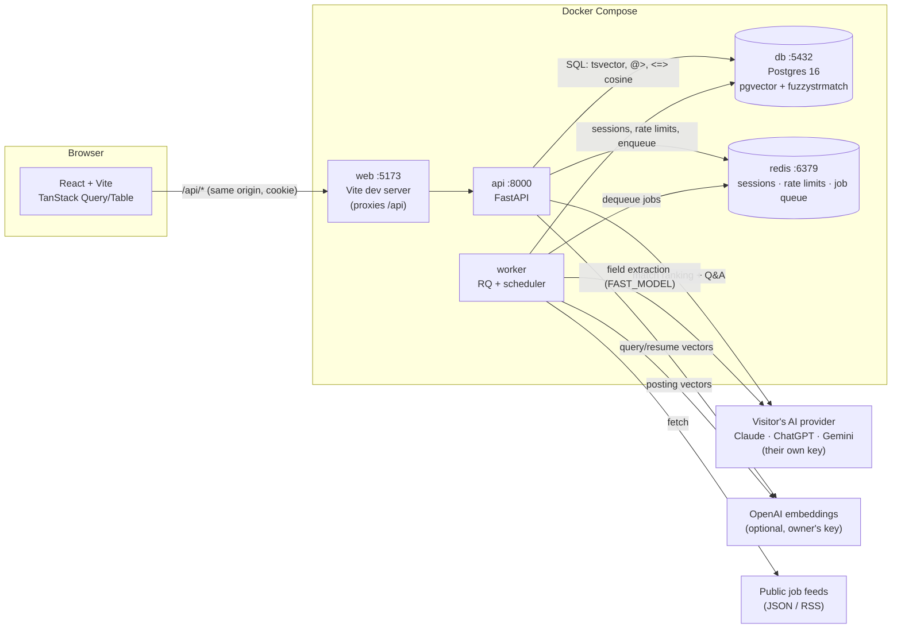

# CoopRadar

**One place to find, track, and win co-op and internship postings.** CoopRadar pulls postings from public job feeds,
CSV exports, and manual entry into a single searchable database. Students track every application on a board.
Upload a resume and Claude ranks the best-fit postings and answers cited questions about each one.

[](https://github.com/mbendari7/COOP-Radar/actions/workflows/ci.yml)

**🌐 Live demo:** _add your link here after deploying (see [docs/DEPLOY.md](docs/DEPLOY.md))_. Click
**Try the demo** to explore a pre-filled account with no sign-up.

## 📚 Documentation

| Read this | When you want to… |
|---|---|
| **[docs/README.md](docs/README.md)** | **Start here**: run it in 5 minutes, understand it, and explain it |
| **[docs/AI_KEYS.md](docs/AI_KEYS.md)** | Get a Claude, ChatGPT, or Gemini API key to use the AI features |
| **[docs/GETTING_STARTED.md](docs/GETTING_STARTED.md)** | Run it on your computer and **use** every feature, step by step |
| **[docs/HOW_IT_WORKS.md](docs/HOW_IT_WORKS.md)** | Understand how the program works, where everything lives, and **how to explain it** |
| **[docs/DEPLOY.md](docs/DEPLOY.md)** | Put it online as a website anyone can use from a link |
| [docs/PROJECT_GUIDE.md](docs/PROJECT_GUIDE.md) | Go deep: every module, the database, testing strategy, recipes for common changes |
| [CLAUDE.md](CLAUDE.md) | See the rules Claude Code follows in this repo |

---

## Why

Students at schools like the University of Guelph check their school's co-op portal (Experience Guelph), LinkedIn,
Glassdoor, and dozens of company career pages by hand every cycle, then track applications in a spreadsheet.
CoopRadar centralizes the postings, makes them fast to search, replaces the spreadsheet, and adds an AI layer.
That layer reads your resume and tells you where you fit and what you're missing, citing the posting or resume line
behind every claim.

## Key features

| Area | What you can do |
|---|---|
| **Browse & search** | Full-text search (title > company/skills > description), filters for city, province, term, work mode, duration, and skills (must have all). Server-side sort and pagination; every view lives in the URL. Remote postings always show up in city filters. |
| **Semantic search** | Toggle "smart search" to match by meaning (pgvector cosine similarity), e.g. "embedded firmware" finds "microcontroller C developer". Falls back to keyword search if embeddings are unavailable. |
| **Similar postings** | Each posting's detail page lists the 5 nearest open postings by embedding. |
| **Accounts** | Email + password (argon2id), HTTP-only session cookie with a 7-day rolling expiry, login rate limiting, password change, permanent account deletion. |
| **Application tracker** | Save postings, move them through 7 statuses (Saved → Applying → Applied → Interview → Offer / Rejected / Withdrawn) with dated notes. Table or drag-and-drop board view, "deadlines this week" panel, stats, CSV export. |
| **Ingestion** | Pluggable source adapters (JSON APIs, RSS). Scheduled every 6 hours plus admin "Run now". Fuzzy de-duplication, closes postings that disappear from their feed, auto-pauses failing sources. Missing fields are extracted from the text and flagged as low-confidence. |
| **Imports** | CSV upload (≤ 1,000 rows, per-line errors, 3 uploads/hour) and a manual "add posting" form. |
| **AI resume matcher** | Upload a PDF or DOCX. The database shortlists the 40 postings whose skills best overlap the resume, then *your* AI ranks the top 20, each with a 0–100 score and a one-sentence reason. Ask follow-up questions per posting; answers stream live and cite `Resume:` / `Posting:` sources, or say "I don't have enough information." |
| **Admin** | Sources page with last-run stats, run history, re-enable for auto-paused sources. |
| **Bring your own AI key** | Visitors paste their own **Claude, ChatGPT (OpenAI), or Gemini** key on the AI key page (with a how-to for each). It stays in their browser and is forwarded per request, never stored. The site owner pays nothing for AI. |
| **One-click demo** | "Try the demo" creates a private account pre-filled with tracker history and resume matches (deleted after 24 h). A daily AI allowance per user keeps hosting costs safe. |

## Architecture



## Tech stack

| Layer | Technology |
|---|---|
| Backend API | Python 3.12, FastAPI, Pydantic v2, SQLAlchemy 2.0 (async, typed `Mapped[]`), asyncpg |
| Database | PostgreSQL 16 with **pgvector** (HNSW cosine index) and **fuzzystrmatch** (Levenshtein dedup); generated `tsvector` + GIN for keyword search |
| Migrations | Alembic (5 migrations; round-trip and drift-checked in CI) |
| Background jobs | Redis + RQ worker with a built-in 6-hour ingest scheduler |
| Auth | argon2id (argon2-cffi), opaque session tokens in Redis, HTTP-only Secure cookies |
| AI | Bring your own key: official SDKs for Anthropic (Claude), OpenAI (ChatGPT), and Google (Gemini) behind one module (`app/ai.py`); the visitor picks the model their key can use. Optional owner keys: Claude fallback and OpenAI `text-embedding-3-small` for smart search |
| Files | pypdf, python-docx (resumes) · pandas (CSV import/export) · feedparser (RSS) · httpx (JSON APIs) |
| Frontend | React 18, TypeScript 5, Vite 6, TanStack Query v5, TanStack Table v8, React Router v6, Tailwind CSS v3, dnd-kit |
| Testing | pytest + pytest-asyncio (177 tests incl. a 10k-row perf budget), Vitest + Testing Library (23 tests) |
| Quality | ruff, mypy `--strict`, eslint, `tsc --noEmit` |
| CI / infra | GitHub Actions (tests + production-image smoke test) · Docker Compose · single production image (FastAPI serves the built site) · Caddy for automatic HTTPS · Render Blueprint |
| AI-assisted workflow | [Spec Kit](https://github.com/github/spec-kit) + Claude Code skills (see below) |

## Quick start

You only need **[Docker Desktop](https://www.docker.com/products/docker-desktop/)** running. **No AI keys are
needed to run it**: visitors (including you) add their own on the site's **AI key** page.

```bash
git clone https://github.com/mbendari7/COOP-Radar.git
cd COOP-Radar
cp .env.example .env        # set POSTGRES_PASSWORD — that's all
```

**Run the website (what a visitor sees):** one command, one URL.
```bash
docker compose -f docker-compose.prod.yml up --build
```
Open **http://localhost:8080** and click **Try the demo**. The database, sample data, and background worker set
themselves up.

**Develop (hot reload for code changes):**
```bash
docker compose up --build
docker compose exec api python -m seed               # first run: sample data
docker compose exec api python -m app.ingest.embed   # optional: smart-search vectors (needs OPENAI_API_KEY)
```
Open **http://localhost:5173** (API docs at http://localhost:8000/docs).

To use resume matching and Q&A, click **AI key** in the top bar and add a Claude, ChatGPT, or Gemini key
(Gemini has a free tier, see **[docs/AI_KEYS.md](docs/AI_KEYS.md)**). New here? Read
**[docs/README.md](docs/README.md)**: run it, understand it, explain it, all on one page.
To put it online: **[docs/DEPLOY.md](docs/DEPLOY.md)**.

## Development commands

```bash
# Backend: lint, strict types, tests, migration drift
docker compose exec api ruff check .
docker compose exec api mypy app
docker compose exec api pytest -q -m "not perf"
docker compose exec api pytest -q -m perf -s        # p95 latency budget on 10,000 postings
docker compose exec api alembic check

# Frontend
cd frontend && npm install
npm run lint && npm run typecheck && npm test && npm run build

# Database
docker compose exec api alembic revision --autogenerate -m "describe change"   # then review it!
docker compose exec api alembic upgrade head
docker compose exec api alembic downgrade -1

# Reset everything (deletes the database volume)
docker compose down -v
```

## Configuration

All configuration is environment variables. See [`.env.example`](.env.example) for the full annotated list.

| Variable | Default | Purpose |
|---|---|---|
| `DATABASE_URL` | (built by compose) | async SQLAlchemy URL (`postgresql+asyncpg://…`) |
| `REDIS_URL` | `redis://redis:6379/0` | sessions, rate limits, job queue |
| `ANTHROPIC_API_KEY` | empty | *Optional.* Lets visitors without their own key use AI on your account (limited by `AI_DAILY_LIMIT`) |
| `OPENAI_API_KEY` | empty | *Optional.* Turns on smart search + similar postings (embeddings) |
| `AGENT_MODEL` / `FAST_MODEL` | `claude-opus-5-5` / `claude-haiku-5-5` | models used with *your* Anthropic key (visitors choose their own) |
| `EMBED_MODEL` | `text-embedding-3-small` | must output 1536-dim vectors |
| `CORS_ORIGINS` | `http://localhost:5173` | only needed if the frontend calls the API cross-origin |
| `COOKIE_SECURE` | `true` | keep `true`; the test suite sets it to `false` |
| `INGEST_INTERVAL_HOURS` | `6` | how often each source is re-fetched |
| `DEMO_ENABLED` | `true` | show the one-click "Try the demo" button |
| `AI_DAILY_LIMIT` | `20` | AI actions (resume uploads + questions) per user per day; `0` = unlimited |

## Project structure

```
COOP-Radar/
├── README.md · LICENSE
├── CLAUDE.md                     Rules for Claude Code sessions in this repo
├── Dockerfile                    Production: the whole website in one container
├── docker-compose.prod.yml       Production: website + Postgres + Redis (+ optional HTTPS)
├── docker-compose.yml            Development: hot-reload stack (db · redis · api · worker · web)
├── render.yaml                   One-click Render Blueprint
├── .env.example                  Every setting, documented
├── docs/                         Guides: getting started, how it works, deploy, deep dive
├── specs/                        Spec Kit feature specs (001–004): spec, plan, data model, contracts, tasks
├── .github/workflows/ci.yml      Lint, types, tests, migrations, perf budget, production-image smoke test
├── .claude/                      Claude Code settings + skills (speckit-* and project skills)
├── .specify/                     Spec Kit: constitution, templates, scripts
├── backend/                      FastAPI app
│   ├── app/
│   │   ├── main.py               App factory, routers, error handler, serves the built website
│   │   ├── config.py             Settings from env vars
│   │   ├── db.py · redis.py      Database session · Redis pool
│   │   ├── deps.py               Who is logged in (user / optional / admin)
│   │   ├── ai.py                 Bring-your-own-key: Claude / ChatGPT / Gemini behind one interface
│   │   ├── llm.py                Claude client + JSON-reply helpers
│   │   ├── worker.py             Background worker + ingest scheduler
│   │   ├── api/                  Routes: postings, auth (+ demo), me, saved, resume, ai (key check), admin, config
│   │   ├── services/             Logic + SQL (postings, auth, demo, usage limits, saved, resume, ingest)
│   │   ├── schemas/              Pydantic request/response models
│   │   ├── models/               Database tables (10)
│   │   ├── ingest/               Feed adapters, runner, dedup, field extraction, embeddings
│   │   └── agent/resume_qa.py    Streaming, cited resume Q&A
│   ├── alembic/versions/         Migrations 0001–0006
│   ├── seed/                     Sample data (python -m seed)
│   ├── scripts/start.sh          Production startup: migrate → seed → worker → web server
│   ├── tests/                    pytest: api/ · ingest/ · resume/ · eval/ · perf/
│   └── Dockerfile · pyproject.toml · alembic.ini
└── frontend/                     React + TypeScript + Vite
    ├── src/
    │   ├── api/                  client.ts (apiFetch/ApiError) + data hooks per resource
    │   ├── pages/                Postings, posting detail, Saved (tracker), Matches, AI key, Account, Admin
    │   └── components/           Table, filters, board, welcome section, demo button, Q&A panel, …
    ├── tests/                    Vitest + Testing Library
    └── Dockerfile · vite.config.ts · tailwind.config.ts
```

## API overview

| Method & path | Auth | Purpose |
|---|---|---|
| `GET /api/postings` | optional | List/search/filter/sort/paginate (`q`, `search_mode`, `city`, `province`, `term`, `work_mode`, `duration`, `skills`, `show_expired`, `show_closed`, `sort`, `order`, `page`, `page_size`) |
| `GET /api/postings/{id}` · `/{id}/similar` · `/meta/filters` | — | Detail · 5 similar · filter dropdown values |
| `POST /api/postings` · `POST /api/postings/upload` | user | Manual posting · CSV import |
| `POST /api/auth/register` · `login` · `logout` · `demo` | — / user | Session cookie auth; `demo` creates a pre-filled demo account |
| `GET/PATCH/DELETE /api/me…` | user | Profile, change password, delete account |
| `GET/POST /api/saved` · `DELETE /api/saved/{id}` · `PATCH …/status` · `POST …/events` · `GET /api/saved/export/csv` | user | Tracker |
| `POST/GET/DELETE /api/resume` · `GET /api/resume/matches` · `POST /api/resume/matches/{posting_id}/ask` (SSE) | user | Resume matcher |
| `GET /api/admin/sources` · `…/{id}/runs` · `POST …/{id}/run` · `PATCH …/{id}` | admin | Ingestion admin |
| `POST /api/ai/check` | — | Verify a visitor's AI key with its provider and list the models it can use (key never stored) |
| `GET /api/config` | — | Which optional features are on (demo, AI, daily AI limit) |
| `GET /api/health` | — | Liveness |

AI routes (`POST /api/resume`, `…/ask`) read the visitor's key from the `X-AI-Provider`, `X-AI-Key`, and
`X-AI-Model` headers. Every error has the same shape: `{"detail": "Human-readable message", "code": "SNAKE_CASE"}`.

## AI-assisted development: Spec Kit + Claude Code skills

Each feature was built with the [Spec Kit](https://github.com/github/spec-kit) loop in Claude Code, guided by the
project constitution at `.specify/memory/constitution.md`:

```
/speckit-specify → /speckit-clarify → /speckit-plan → /speckit-checklist → /speckit-tasks
→ /speckit-analyze → /speckit-implement → /speckit-converge (repeat) → /log-agentic-work → PR
```

Project skills in `.claude/skills/` encode this repo's conventions, so Claude Code follows them automatically:

| Skill | Use it for |
|---|---|
| `api-conventions` | Any backend endpoint, model, schema, service, or test: layering, error shape, safe SQL, test fixtures |
| `frontend-tables` | Any page, table, form, or API hook: `apiFetch`, server-side sorting, URL state, accessibility |
| `agent-tools` | Anything touching Claude: model settings, prompt-injection guards, fallbacks, evals, the planned tool-use agent + MCP server |
| `db-migration` (`/db-migration "what changed"`) | Safe Alembic migrations: autogenerate, review, round-trip, `alembic check` |
| `log-agentic-work` (`/log-agentic-work`) | Append an honest entry to `docs/agentic-workflow.md` |

The prompts used to spec every feature are in [`docs/speckit-prompts.md`](docs/speckit-prompts.md).

## Project rules (from the constitution)

- Searching, filtering, sorting, and pagination happen in SQL, never in the browser. Sort columns are whitelisted
  and user input is never interpolated into SQL.
- Every endpoint has Pydantic schemas and tests; CI must be green before merge.
- Performance budget: list/search p95 < 300 ms on 10,000 postings (measured in CI).
- Honest AI: claims cite the resume or posting; when the context doesn't contain the answer, the assistant says so.
  Posting and resume text is treated as data, never instructions.
- Privacy: resumes are deletable at any time; only extracted text is stored; secrets live only in env vars.
- Responsible data: public APIs/feeds, uploads, and manual entry only; respect robots.txt and terms; no logins scraped.
- Accessible, mobile-first UI (keyboard reachable, visible focus, WCAG AA, usable at 375 px).

## Repository workflow

Everything lives on **`main`**. Build new work on a short-lived branch (e.g. `005-deploy`), open a pull request into
`main`, and merge once CI is green. Commit messages are conventional (`feat:`, `fix:`, `docs:`, …) with no AI
attribution lines.

## Roadmap

- [x] 001 Browse & search
- [x] 002 Accounts & application tracker
- [x] 003 Real postings ingestion & semantic search
- [x] 004 AI resume matcher (upload, ranked matches, cited streaming Q&A)
- [ ] 004 remainder: tool-use assistant (search/compare/save with confirmation), MCP server, `agent_runs` logging, YAML eval runner
- [ ] Real public job-board sources (each documented with its terms)
- [x] Deployable website: one-container image, one-click demo, daily AI limits, Render Blueprint
- [ ] Hosted live demo link + error tracking / usage dashboard

## License

MIT
