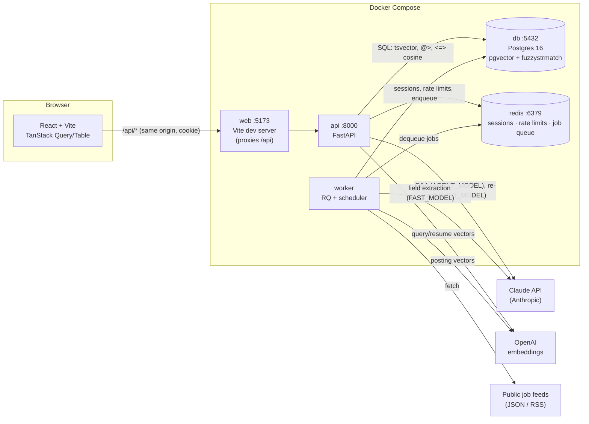

# CoopRadar

**One place to find, track, and win co-op and internship postings.** CoopRadar pulls postings from public job feeds,
CSV exports, and manual entry into a single searchable database. Students track every application on a board.
Upload a resume and Claude ranks the best-fit postings and answers cited questions about each one.

[](https://github.com/mbendari7/COOP-Radar/actions/workflows/ci.yml)

> New to the codebase? Read **[docs/PROJECT_GUIDE.md](docs/PROJECT_GUIDE.md)**. It walks through how every part
> works, how a request flows through the system, and how to extend it.

---

## Why

Students at schools like the University of Guelph check their school's co-op portal (Experience Guelph), LinkedIn,
Glassdoor, and dozens of company career pages by hand every cycle, then track applications in a spreadsheet.
CoopRadar centralizes the postings, makes them fast to search, replaces the spreadsheet, and adds an AI layer.
That layer reads your resume and tells you where you fit and what you're missing, citing the posting or resume line
behind every claim.

## Key features

| Area | What you can do |
|---|---|
| **Browse & search** | Full-text search (title > company/skills > description), filters for city, province, term, work mode, duration, and skills (must have all). Server-side sort and pagination; every view lives in the URL. Remote postings always show up in city filters. |
| **Semantic search** | Toggle "smart search" to match by meaning (pgvector cosine similarity), e.g. "embedded firmware" finds "microcontroller C developer". Falls back to keyword search if embeddings are unavailable. |
| **Similar postings** | Each posting's detail page lists the 5 nearest open postings by embedding. |
| **Accounts** | Email + password (argon2id), HTTP-only session cookie with a 7-day rolling expiry, login rate limiting, password change, permanent account deletion. |
| **Application tracker** | Save postings, move them through 7 statuses (Saved → Applying → Applied → Interview → Offer / Rejected / Withdrawn) with dated notes. Table or drag-and-drop board view, "deadlines this week" panel, stats, CSV export. |
| **Ingestion** | Pluggable source adapters (JSON APIs, RSS). Scheduled every 6 hours plus admin "Run now". Fuzzy de-duplication, closes postings that disappear from their feed, auto-pauses failing sources. Missing fields are extracted from the text and flagged as low-confidence. |
| **Imports** | CSV upload (≤ 1,000 rows, per-line errors, 3 uploads/hour) and a manual "add posting" form. |
| **AI resume matcher** | Upload a PDF or DOCX. Vector search picks the top 40 candidates, then Claude re-ranks them into the top 20, each with a 0–100 score and a one-sentence reason. Ask follow-up questions per posting; answers stream live and cite `Resume:` / `Posting:` sources, or say "I don't have enough information." |
| **Admin** | Sources page with last-run stats, run history, re-enable for auto-paused sources. |

## Architecture



## Tech stack

| Layer | Technology |
|---|---|
| Backend API | Python 3.12, FastAPI, Pydantic v2, SQLAlchemy 2.0 (async, typed `Mapped[]`), asyncpg |
| Database | PostgreSQL 16 with **pgvector** (HNSW cosine index) and **fuzzystrmatch** (Levenshtein dedup); generated `tsvector` + GIN for keyword search |
| Migrations | Alembic (5 migrations; round-trip and drift-checked in CI) |
| Background jobs | Redis + RQ worker with a built-in 6-hour ingest scheduler |
| Auth | argon2id (argon2-cffi), opaque session tokens in Redis, HTTP-only Secure cookies |
| AI | Anthropic Python SDK. `AGENT_MODEL` (default `claude-opus-5-5`) answers Q&A; `FAST_MODEL` (default `claude-haiku-5-5`) re-ranks and extracts. OpenAI `text-embedding-3-small` (1536-d) for embeddings |
| Files | pypdf, python-docx (resumes) · pandas (CSV import/export) · feedparser (RSS) · httpx (JSON APIs) |
| Frontend | React 18, TypeScript 5, Vite 6, TanStack Query v5, TanStack Table v8, React Router v6, Tailwind CSS v3, dnd-kit |
| Testing | pytest + pytest-asyncio (141 tests incl. a 10k-row perf budget), Vitest + Testing Library (17 tests) |
| Quality | ruff, mypy `--strict`, eslint, `tsc --noEmit` |
| CI / infra | GitHub Actions · Docker Compose · nginx (production frontend image) |
| AI-assisted workflow | [Spec Kit](https://github.com/github/spec-kit) + Claude Code skills (see below) |

## Getting started

### Prerequisites
- [Docker Desktop](https://www.docker.com/products/docker-desktop/) (or Docker Engine + Compose v2)
- Optional, for AI features: an [Anthropic API key](https://console.anthropic.com/) and an [OpenAI API key](https://platform.openai.com/api-keys)

### Run it

```bash
git clone https://github.com/mbendari7/COOP-Radar.git
cd COOP-Radar
cp .env.example .env            # then edit: set POSTGRES_PASSWORD, and the AI keys if you have them

docker compose up --build       # db, redis, api (runs migrations), worker, web

# in a second terminal — load sample data (55 postings, skills taxonomy, 2 demo sources)
docker compose exec api python -m seed
# give postings embeddings so semantic search + resume matching work (needs OPENAI_API_KEY)
docker compose exec api python -m app.ingest.embed
```

Open **http://localhost:5173**. The interactive API docs are at **http://localhost:8000/docs**.

**Make yourself an admin** (to see the Sources page). Register in the UI, then run:
```bash
docker compose exec db psql -U coopradar -c "UPDATE users SET is_admin = TRUE WHERE email = 'you@example.com';"
```

Without AI keys everything except semantic search, similar postings, and resume matching works. Those features
degrade cleanly: keyword fallback, empty lists, or a clear "AI unavailable" message.

## Development commands

```bash
# Backend: lint, strict types, tests, migration drift
docker compose exec api ruff check .
docker compose exec api mypy app
docker compose exec api pytest -q -m "not perf"
docker compose exec api pytest -q -m perf -s        # p95 latency budget on 10,000 postings
docker compose exec api alembic check

# Frontend
cd frontend && npm install
npm run lint && npm run typecheck && npm test && npm run build

# Database
docker compose exec api alembic revision --autogenerate -m "describe change"   # then review it!
docker compose exec api alembic upgrade head
docker compose exec api alembic downgrade -1

# Reset everything (deletes the database volume)
docker compose down -v
```

## Configuration

All configuration is environment variables. See [`.env.example`](.env.example) for the full annotated list.

| Variable | Default | Purpose |
|---|---|---|
| `DATABASE_URL` | (built by compose) | async SQLAlchemy URL (`postgresql+asyncpg://…`) |
| `REDIS_URL` | `redis://redis:6379/0` | sessions, rate limits, job queue |
| `ANTHROPIC_API_KEY` | empty | Claude: Q&A, re-ranking, extraction |
| `OPENAI_API_KEY` | empty | embeddings |
| `AGENT_MODEL` / `FAST_MODEL` | `claude-opus-5-5` / `claude-haiku-5-5` | which Claude models to use |
| `EMBED_MODEL` | `text-embedding-3-small` | must output 1536-dim vectors |
| `CORS_ORIGINS` | `http://localhost:5173` | only needed if the frontend calls the API cross-origin |
| `COOKIE_SECURE` | `true` | keep `true`; the test suite sets it to `false` |
| `INGEST_INTERVAL_HOURS` | `6` | how often each source is re-fetched |

## Project structure

```
COOP-Radar/
├── CLAUDE.md                     Instructions for Claude Code sessions in this repo
├── docker-compose.yml            db · redis · api · worker · web
├── .env.example                  Every config variable, documented
├── .github/workflows/ci.yml      Backend + frontend quality gates
├── .claude/
│   ├── settings.json             Repo-wide Claude Code settings (no AI commit attribution)
│   └── skills/                   speckit-* workflow skills + project skills (see below)
├── .specify/                     Spec Kit: constitution, templates, scripts
├── specs/                        One folder per feature: spec, plan, data model, contracts, tasks
│   ├── 001-browse-search-postings/
│   ├── 002-accounts-tracker/
│   ├── 003-ingestion-search/
│   └── 004-ai-resume-matcher/
├── docs/
│   ├── PROJECT_GUIDE.md          Deep dive: how the whole system works
│   ├── agentic-workflow.md       Log of AI-assisted work and human review
│   ├── progress.md               Status + open work
│   ├── speckit-prompts.md        The prompts used to spec each feature
│   └── history/                  Original kickoff prompt and CLAUDE.md
├── backend/
│   ├── Dockerfile · pyproject.toml · alembic.ini
│   ├── alembic/versions/         0001 postings → 0002 auth → 0003 tracker → 0004 ingestion → 0005 resume matcher
│   ├── seed/                     python -m seed (postings, skills taxonomy, demo sources)
│   ├── app/
│   │   ├── main.py               App factory, routers, unified error handler, /api/health
│   │   ├── config.py             Settings from env vars
│   │   ├── db.py · redis.py      Async engine/session · Redis pool
│   │   ├── deps.py               get_current_user / get_optional_user / get_admin_user
│   │   ├── llm.py                Claude client + response helpers
│   │   ├── worker.py             RQ worker + ingest scheduler
│   │   ├── api/                  Routers: postings, auth, me, saved, resume, admin
│   │   ├── services/             Business logic + SQL for each router
│   │   ├── schemas/              Pydantic request/response models
│   │   ├── models/               SQLAlchemy tables (10)
│   │   ├── ingest/               Adapters (json_api, rss), runner, dedup, extract, embed, csv_validator
│   │   └── agent/resume_qa.py    Streaming, cited resume Q&A
│   └── tests/                    api/ · ingest/ · resume/ · eval/ · perf/ (+ conftest fixtures)
└── frontend/
    ├── Dockerfile · nginx.conf · vite.config.ts · tailwind.config.ts
    ├── src/
    │   ├── api/                  client.ts (apiFetch/ApiError) + TanStack Query hooks per resource
    │   ├── pages/                Postings list/detail, Saved (tracker), Matches, Account, Admin
    │   └── components/           Table, filters, board, auth modal, resume upload, Q&A panel, …
    └── tests/                    Vitest + Testing Library
```

## API overview

| Method & path | Auth | Purpose |
|---|---|---|
| `GET /api/postings` | optional | List/search/filter/sort/paginate (`q`, `search_mode`, `city`, `province`, `term`, `work_mode`, `duration`, `skills`, `show_expired`, `show_closed`, `sort`, `order`, `page`, `page_size`) |
| `GET /api/postings/{id}` · `/{id}/similar` · `/meta/filters` | — | Detail · 5 similar · filter dropdown values |
| `POST /api/postings` · `POST /api/postings/upload` | user | Manual posting · CSV import |
| `POST /api/auth/register` · `login` · `logout` | — / user | Session cookie auth |
| `GET/PATCH/DELETE /api/me…` | user | Profile, change password, delete account |
| `GET/POST /api/saved` · `DELETE /api/saved/{id}` · `PATCH …/status` · `POST …/events` · `GET /api/saved/export/csv` | user | Tracker |
| `POST/GET/DELETE /api/resume` · `GET /api/resume/matches` · `POST /api/resume/matches/{posting_id}/ask` (SSE) | user | Resume matcher |
| `GET /api/admin/sources` · `…/{id}/runs` · `POST …/{id}/run` · `PATCH …/{id}` | admin | Ingestion admin |
| `GET /api/health` | — | Liveness |

Every error has the same shape: `{"detail": "Human-readable message", "code": "SNAKE_CASE"}`.

## AI-assisted development: Spec Kit + Claude Code skills

Each feature was built with the [Spec Kit](https://github.com/github/spec-kit) loop in Claude Code, guided by the
project constitution at `.specify/memory/constitution.md`:

```
/speckit-specify → /speckit-clarify → /speckit-plan → /speckit-checklist → /speckit-tasks
→ /speckit-analyze → /speckit-implement → /speckit-converge (repeat) → /log-agentic-work → PR
```

Project skills in `.claude/skills/` encode this repo's conventions, so Claude Code follows them automatically:

| Skill | Use it for |
|---|---|
| `api-conventions` | Any backend endpoint, model, schema, service, or test: layering, error shape, safe SQL, test fixtures |
| `frontend-tables` | Any page, table, form, or API hook: `apiFetch`, server-side sorting, URL state, accessibility |
| `agent-tools` | Anything touching Claude: model settings, prompt-injection guards, fallbacks, evals, the planned tool-use agent + MCP server |
| `db-migration` (`/db-migration "what changed"`) | Safe Alembic migrations: autogenerate, review, round-trip, `alembic check` |
| `log-agentic-work` (`/log-agentic-work`) | Append an honest entry to `docs/agentic-workflow.md` |

The prompts used to spec every feature are in [`docs/speckit-prompts.md`](docs/speckit-prompts.md).

## Project rules (from the constitution)

- Searching, filtering, sorting, and pagination happen in SQL, never in the browser. Sort columns are whitelisted
  and user input is never interpolated into SQL.
- Every endpoint has Pydantic schemas and tests; CI must be green before merge.
- Performance budget: list/search p95 < 300 ms on 10,000 postings (measured in CI).
- Honest AI: claims cite the resume or posting; when the context doesn't contain the answer, the assistant says so.
  Posting and resume text is treated as data, never instructions.
- Privacy: resumes are deletable at any time; only extracted text is stored; secrets live only in env vars.
- Responsible data: public APIs/feeds, uploads, and manual entry only; respect robots.txt and terms; no logins scraped.
- Accessible, mobile-first UI (keyboard reachable, visible focus, WCAG AA, usable at 375 px).

## Roadmap

- [x] 001 Browse & search
- [x] 002 Accounts & application tracker
- [x] 003 Real postings ingestion & semantic search
- [x] 004 AI resume matcher (upload, ranked matches, cited streaming Q&A)
- [ ] 004 remainder: tool-use assistant (search/compare/save with confirmation), MCP server, `agent_runs` logging, YAML eval runner
- [ ] Real public job-board sources (each documented with its terms)
- [ ] 005 Deploy & observability

## License

MIT
