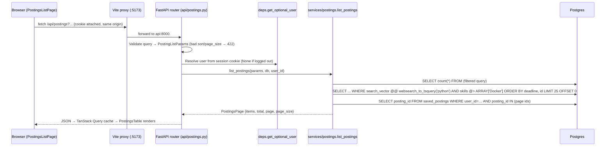
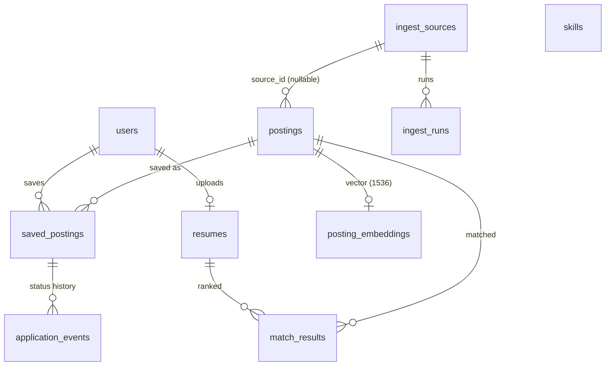
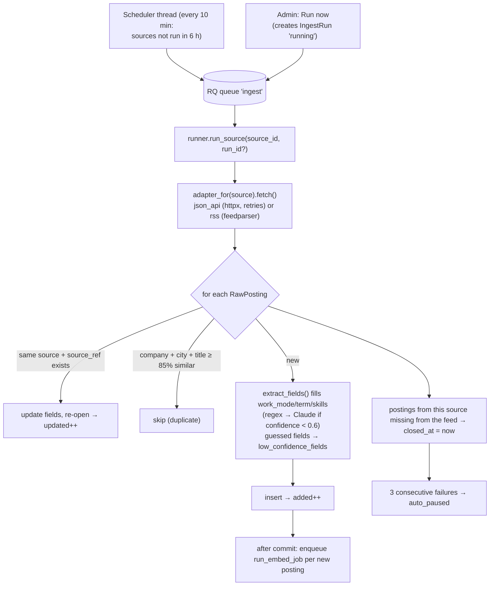

# CoopRadar — The Project Guide

This is the deep technical reference: how every part works, so you can debug and extend it.
Start with the shorter guides if you haven't: **[USER_GUIDE.md](USER_GUIDE.md)** (use it, put it online, tips) and
**[HOW_IT_WORKS.md](HOW_IT_WORKS.md)** (how it works, plus how to explain it).

**Contents**
1. [The big picture](#1-the-big-picture)
2. [Your first run (and what to check)](#2-your-first-run-and-what-to-check)
3. [How a request flows through the system](#3-how-a-request-flows-through-the-system)
4. [The database](#4-the-database)
5. [Backend, module by module](#5-backend-module-by-module)
6. [Feature deep dives](#6-feature-deep-dives)
7. [Frontend](#7-frontend)
8. [Testing: how it works and why](#8-testing-how-it-works-and-why)
9. [The AI-assisted workflow (Spec Kit + skills)](#9-the-ai-assisted-workflow-spec-kit--skills)
10. [Recipes: common changes, step by step](#10-recipes-common-changes-step-by-step)
11. [Lessons from the 2026-10-10 review](#11-lessons-from-the-2026-10-10-review)
12. [Known gaps and ideas](#12-known-gaps-and-ideas)
13. [Troubleshooting](#13-troubleshooting)

---

## 1. The big picture

CoopRadar is a **monorepo** with a Python API, a React single-page app, and five Docker containers:

| Container | What it is | Why it exists |
|---|---|---|
| `db` | PostgreSQL 16 (`pgvector/pgvector:pg16` image) | Single source of truth. Also does keyword search (`tsvector`), skill-overlap ranking (array `unnest`), and optional vector search (`pgvector`), so there's no separate search engine to run. |
| `redis` | Redis 7 | Three jobs: login sessions, rate-limit counters, and the RQ job queue. |
| `api` | FastAPI on Uvicorn, port 8000 | Every HTTP endpoint. Runs `alembic upgrade head` on start. |
| `worker` | `python -m app.worker` (same image as `api`) | Executes background jobs (ingesting feeds, generating embeddings) and schedules ingest runs every 6 hours. |
| `web` | Vite dev server, port 5173 | Serves the React app with hot reload and **proxies `/api` to `api`**, so the browser only ever talks to one origin. |

Three external services are optional: **Anthropic** (Claude) for re-ranking, extraction, and Q&A; **OpenAI** for
embeddings; and **public job feeds** for postings. Without API keys the app still works; the AI features degrade
gracefully.

The guiding rules (from `.specify/memory/constitution.md`) explain most design decisions you'll see:
- **Data stays in the database layer.** Filtering, sorting, and paging are SQL, never JavaScript arrays.
- **Correctness first.** Schemas plus tests for every endpoint; CI gates everything.
- **Honest AI.** Cite sources, admit "not enough information", and never let model output write data unconfirmed.
- **Privacy.** Resumes are deletable and only extracted text is stored.

---

## 2. Your first run (and what to check)

```bash
cp .env.example .env              # set POSTGRES_PASSWORD; add ANTHROPIC_API_KEY / OPENAI_API_KEY if you have them
docker compose up --build         # wait for "Application startup complete" from api
docker compose exec api python -m seed            # 55 postings, 106 skills, 2 demo sources
docker compose exec api python -m app.ingest.embed  # vectors for semantic search + matching (OpenAI key)
```

Then walk through the app and check that each piece works. This doubles as your manual test plan:

1. **http://localhost:5173**: about 50 open postings (5 seed postings are expired). Type `python`; the list
   narrows and the URL gains `?q=python`. Refresh: the state survives.
2. Pick **City: Waterloo**. Remote postings still appear (by design, FR-004a). Add skills `Python` and `Docker`;
   only postings with *both* remain.
3. Click a column header to sort, change page size, and open a posting. **Similar postings** shows 5 items if
   embeddings exist (empty otherwise).
4. Toggle **smart search** and try `low-level firmware`. Results come back ranked by meaning.
5. **Register** (password ≥ 10 chars). Bookmark a posting, then open **Saved**: change status, add a note with a date,
   switch to **Board** and drag a card, and **↓ CSV** to export.
6. **My resume**: drop a PDF/DOCX resume (signed out is fine: a temporary account is created). With no AI key you
   immediately get skills found, in-demand skills missing, and 20 skill-ranked matches. Add a key on **AI key**, then
   try **Get my AI review**, **Re-rank with my AI**, and a match's **Tailor my resume**. Answers stream in.
7. Make yourself admin (see the README), refresh, and open **Admin**. Click **Run now** on "Acme Jobs (Dev Fixture)".
   After a few seconds, **History** shows a run with 5 added. Run it again: 0 added, 5 updated, 0 closed.
8. **http://localhost:8000/docs**: the interactive OpenAPI docs. Try endpoints directly.

---

## 3. How a request flows through the system

Trace `GET /api/postings?q=python&skills=Docker&sort=deadline&order=asc` end to end:



Every endpoint follows the same layering:

```
router (app/api/*.py)        thin: declare dependencies, call one service function, return
  └─ service (app/services/*.py)   all logic + SQL; owns commit()
       └─ models (app/models/*.py)      SQLAlchemy tables
schemas (app/schemas/*.py)   Pydantic models at the edges (validate input, shape output)
```

**Errors** always look like `{"detail": "Posting not found", "code": "POSTING_NOT_FOUND"}`. Services raise
`HTTPException(detail={"detail": …, "code": …})`, and `http_exception_handler` in `app/main.py` flattens it. The
frontend's `ApiError` reads `code`, so UI logic never depends on message text.

---

## 4. The database



| Table | Key columns | Notes |
|---|---|---|
| `postings` | title, company, city, province, work_mode (enum), term, duration_months (4/8/12/16), deadline, skills `text[]`, description, `search_vector` | `search_vector` is a **generated column**: Postgres rebuilds it on every write, weighting title A > company/skills B > description C. GIN indexes on `search_vector` and `skills`; B-tree indexes on every sort/filter column. Ingest fields: `source_id`, `source_ref` (unique per source), `closed_at`, `low_confidence_fields`. |
| `users` | email (unique, lowercase), hashed_password (argon2id), is_admin | |
| `saved_postings` | user_id, posting_id (unique together), status (nullable enum, 7 values), saved_at, last_status_at | CASCADE on user/posting delete. |
| `application_events` | saved_posting_id, status, notes, event_date, created_at | One row per status change: the tracker's history. |
| `ingest_sources` | name, adapter_type (`json_api`/`rss`/`csv`/`manual`), config (JSONB: `url`, `field_map`), enabled, auto_paused, consecutive_failures | |
| `ingest_runs` | status (`running`/`success`/`partial`/`failed`), added/updated/closed/errors, error_log | |
| `skills` | name (unique), aliases `text[]`, category | The taxonomy used by extraction (`seed/skills.py`). |
| `posting_embeddings` | posting_id (PK), embedding `vector(1536)`, model | HNSW index with `vector_cosine_ops` for fast `<=>` queries. |
| `resumes` | user_id (unique: one per user), filename, file_size, extracted_text | The file itself is never stored. |
| `match_results` | resume_id, posting_id (unique together), score 0–100, reason | Replaced on every upload. |

**Migrations** (`backend/alembic/versions/`) build this schema step by step: 0001 postings, 0002 auth and saved
postings, 0003 tracker events, 0004 ingestion, pgvector, and admin, 0005 resume matcher. Two subtleties:
- Generated columns may only call IMMUTABLE functions. `array_to_string()` is only STABLE, so 0001 creates the
  wrapper `coopradar_skills_text()`. The model attaches the same function so `create_all()` (used by tests) works.
- Every index exists in **both** the migration and the model's `__table_args__`. CI runs `alembic check` to prove
  they agree. Otherwise the next `--autogenerate` would silently propose dropping indexes.

---

## 5. Backend, module by module

| File | Responsibility |
|---|---|
| `app/main.py` | `create_app()`: lifespan (checks the DB, opens the Redis pool), CORS, the flat error handler, routers under `/api`, and `/api/health`. |
| `app/config.py` | `Settings` (pydantic-settings) reads every env var once (`get_settings()` is cached). AI keys and models live here. |
| `app/db.py` | Async engine (`pool_pre_ping`), `AsyncSessionLocal`, and the `get_db` dependency (one session per request). |
| `app/redis.py` | Creates the async Redis pool at startup; `get_redis` dependency. |
| `app/deps.py` | `get_current_user` (cookie → Redis `session:<token>` → `users` row; refreshes the 7-day TTL; 401/503), `get_optional_user` (same, but `None` instead of 401), `get_admin_user` (403 unless `is_admin`). |
| `app/llm.py` | `get_client()` builds the Anthropic client from settings; `response_text()` joins text blocks and skips thinking blocks; `parse_json()` tolerates code fences and prose. |
| `app/worker.py` | RQ worker plus a scheduler thread that enqueues due ingest sources every 10 minutes. Also `create_queue()`, used by the API to enqueue jobs. |
| `app/api/postings.py` | List, detail, similar, filter metadata, CSV upload (rate-limited 3/hour per user via a Redis counter), manual create. |
| `app/api/auth.py`, `me.py` | Register, login (5 failed attempts / 15 min → 429), logout, demo + guest temporary accounts, profile, change password, delete account, claim (keep) a temporary account. |
| `app/api/saved.py` | Tracker CRUD, status changes (each one writes an event), CSV export. |
| `app/api/resume.py` | Upload (AI optional)/get/delete a resume, list matches, AI re-rank, insights (GET free + cached / POST AI review), and the SSE assistant (`mode`: question · tailor · cover_letter). |
| `app/api/admin.py` | Sources list, run history, trigger a run, enable/re-enable a source. |
| `app/services/*.py` | The logic behind each router (see section 6). |
| `app/ingest/` | `base.py` (`RawPosting`, `BaseAdapter`), `boards.py` (Greenhouse / Lever / Ashby adapters, location filter + parser, HTML to text), `json_api.py`, `rss.py`, `registry.py` (adapter_type → class), `runner.py` (one ingest pass, estimated deadlines), `dedup.py` (difflib title similarity), `skill_match.py` (context-aware skill detection), `extract.py` (skills/term/work mode, then Claude if the owner set a key), `embed.py` (OpenAI + backfill CLI; skipped without a key), `csv_validator.py`. |
| `app/agent/resume_qa.py` | The streaming, citation-grounded Q&A. |
| `seed/` | `python -m seed`: skills (always; aliases updated on re-run), `job_boards.py` (27 employers), sample postings, and two fixture sources, each behind a `SEED_*` flag. Idempotent. |
| `app/services/insights.py` | Free insights (skills found, in-demand skills missing via `unnest … GROUP BY`) and the cached AI review. |

---

## 6. Feature deep dives

### 6.1 Search, filters, sort, pagination (`services/postings.list_postings`)
- **Keyword search**: `websearch_to_tsquery('english', q)` matched against the generated `search_vector`. It
  handles `"exact phrase"` and `-exclude` and never errors on odd characters.
- **Semantic search** (`search_mode=semantic`): embeds `q` with OpenAI, then `ORDER BY embedding <=> query_vec`.
  If embedding fails, it falls back to keyword search. Postings without a vector are excluded from semantic results.
- **Filters** are AND-ed `WHERE` clauses: city (`ILIKE`, **OR work_mode = remote**), province, term, work_mode,
  duration (`IN`, so it's OR within the field), and skills (`skills @> ARRAY[...]`, meaning *all* selected skills).
  Expired (`deadline < today`) and closed postings are hidden unless `show_expired` / `show_closed` is set.
- **Sort** goes through `_SORT_MAP`, a whitelist dict, with `id` as a tiebreaker so pages never overlap.
  **Pagination** uses `OFFSET/LIMIT` with `page_size` limited to 10/25/50. `total` is a `count()` over the same
  filtered query.
- `is_saved` is computed with one extra query for the current page only, so it never costs N+1 queries.
- The perf test inserts 10,000 postings and checks p95 latency < 300 ms (measured: ~55 ms).

### 6.2 Auth and sessions (`services/auth.py`, `deps.py`)
1. Register/login → argon2id hash/verify → `secrets.token_hex(32)` → Redis `HSET session:<token> user_id …` with a
   7-day TTL.
2. The cookie `session=<token>` is HttpOnly (JS can't read it), SameSite=Lax (CSRF protection), and Secure.
3. Every authenticated request runs `get_current_user`, which also resets the TTL (a sliding session).
4. Logout deletes the Redis key, so the session dies immediately. Unknown email and wrong password return the same
   401 (no account enumeration), and an unknown email still runs a dummy hash so response timing matches.

### 6.3 Application tracker (`services/saved_postings.py`)
- Save uses `INSERT … ON CONFLICT DO NOTHING`, so it's idempotent (201 the first time, 200 after).
- Each status change updates `saved_postings.status`/`last_status_at` and inserts an `application_events` row.
- The list response also carries `status_counts` (a `GROUP BY` over *all* the user's saves), stats, and
  `deadlines_this_week` (postings due in the next 7 days that aren't offer/rejected/withdrawn).
- Every query is scoped by `user_id`. Another user's saved ID returns 404, never 403, so you can't probe for IDs.

### 6.4 Ingestion pipeline (`ingest/`, `worker.py`)



**Career boards (the main source):** `seed/job_boards.py` lists 27 employers as `(company, adapter_type, board)`,
with adapter types `greenhouse`, `lever`, and `ashby`. These official public job-board APIs exist for syndicating a
company's openings. `boards.py` keeps only locations matching `INGEST_LOCATION_FILTER` (Canada by default; for
multi-location jobs it picks the first matching one), parses `City, Province`, and maps work mode. Most boards
publish no deadline, so the runner sets an *estimated* apply-by date 45 days out, flags it in
`low_confidence_fields`, and pushes it forward on each run while the job is still listed. To add an employer,
append a tuple and redeploy (or insert an `ingest_sources` row). For other feeds use `adapter_type='json_api'` with
a `field_map`, or write an adapter (see recipes). Always check the site's terms and robots.txt first.

### 6.5 Resume matcher (`services/resume.py`), with AI optional
1. **Credentials** (`app/ai.py → ai_credentials`): the visitor's key arrives as `X-AI-Provider` / `X-AI-Key` /
   `X-AI-Model` headers. With no key, the owner's `ANTHROPIC_API_KEY` is used if set (then `AI_DAILY_LIMIT`
   applies via `services/usage.py`). Upload uses `ai_credentials("rank", optional=True)`: with no key at all it gets
   `None` and ranks for free. AI-only endpoints (`rematch`, insights `POST`, `ask`) return 400 `AI_KEY_REQUIRED`.
2. **Upload**: the extension must be `.pdf`/`.docx` and the file ≤ 5 MB. Text comes out via pypdf/python-docx, and
   empty text gives 422. The old resume is deleted (its matches cascade), and the new one is stored.
3. **Stage 1, recall (`find_candidates`)**: by default, `skills_in_text` finds which posting skills appear in the
   resume (`skill_match.mentions`: whole-word, so "C" ≠ "C++", plus context rules for C/R/Go/Spring), and SQL ranks
   open postings by coverage = matched ÷ `greatest(cardinality(skills), 3)`, adjusted by `_student_fit` (×0.5 for
   `SENIOR_TITLE_PATTERN`, +0.25 for `STUDENT_TITLE_PATTERN`, capped at 1). No AI, no cost. If the owner set
   `OPENAI_API_KEY`, pgvector cosine similarity (with the same student fit) is used instead. Without AI the top 20
   are stored with a skill reason ("You have Python, SQL; it also asks for Go.").
4. **Stage 2, precision (`rank_with_ai`)**: one call through `ai.complete()` to the visitor's provider/model scores
   every candidate 0–100 with a reason as a JSON array. The code drops invented IDs and duplicates, clamps scores,
   and keeps the top 20.
5. **Fallback**: unusable output → the stage-1 relevance becomes the score. A rejected key, unknown model, or
   exhausted credit is **raised** (400/429 with a clear code) rather than hidden, and the old resume is kept
   (the transaction rolls back).
6. **Re-rank** (`POST /api/resume/rematch`): re-runs both stages on the stored text with the visitor's AI and
   replaces the stored matches.
7. **Assistant** (`agent/resume_qa.py`): `POST /api/resume/matches/{posting_id}/ask` with `mode` = `question`
   (question required), `tailor`, or `cover_letter`. It checks that the posting is in *your* matches, then streams
   Server-Sent Events through `ai.stream()`: `data: {"delta": "…"}` … `data: [DONE]`. The question prompt forces
   `Resume:`/`Posting:` citations and the exact "I don't have enough information to answer that." line. Every
   prompt treats the tagged posting/resume text as data (a prompt-injection guard) and forbids inventing
   experience. Provider errors arrive in-band as `data: {"error": "…"}` because the HTTP status is already 200 once
   streaming starts.
8. **Insights** (`services/insights.py`): `GET /api/resume/insights` returns skills found plus the 8 most-requested
   missing skills (free), and `resumes.insights` if cached. `POST` sends the resume and those market numbers to the
   visitor's AI for strict JSON (summary, strengths, improvements, tailoring tips, roles, keywords), validates and
   truncates every field, caches it, and returns 502 `AI_BAD_RESPONSE` if unparseable.

### 6.6 Temporary accounts (`services/demo.py`)
`POST /api/auth/demo` (pre-filled tracker + resume + skill matches) and `POST /api/auth/guest` (empty, used when a
signed-out visitor uploads a resume) both create a user with `is_demo = true` and a random unknown password,
rate-limited to 10 per network per hour. Accounts older than 7 days are deleted (cascading) whenever a new one is
created. `POST /api/me/claim {email, password}` keeps one: email uniqueness (409 `EMAIL_TAKEN`), argon2 hash,
`is_demo = false`.

**`app/ai.py` in one paragraph:** `complete()` and `stream()` hide three official SDKs (`anthropic`, `openai`,
`google-genai`). `list_models()` powers `POST /api/ai/check` (rate-limited per IP) so the UI offers only models the
key can use, with `recommended_model()` pre-selecting a sensible default. `_translate()` maps every SDK's errors
(including Google's 400 + `API_KEY_INVALID`) to `AI_KEY_INVALID`, `AI_MODEL_INVALID`, `AI_PROVIDER_RATE_LIMITED`,
or `AI_PROVIDER_ERROR`, and never includes the key. `AICredentials` hides the key from `repr()`.

**Why two stages?** SQL can compare skills across every posting instantly and for free; an LLM is precise but costs
the visitor per posting. SQL narrows thousands of postings to 40, then one LLM call ranks just those.

---

## 7. Frontend

| Piece | Where | Notes |
|---|---|---|
| Providers | `src/main.tsx` | `BrowserRouter` plus `QueryClientProvider` (30 s staleTime, 1 retry). |
| Routes | `src/App.tsx` | `/` jobs · `/postings/:id` detail · `/resume` My resume (upload, insights, matches, assistant) · `/saved` tracker · `/ai-key` bring-your-own-key · `/account` · `/add` CSV + manual entry · `/admin/sources` · `/matches` → `/resume`. Signed-out visitors see `WelcomeHero` ("Analyze my resume"). Heavy pages are lazy-loaded. |
| Resume page | `pages/ResumePage.tsx` | `ResumeDropzone` (guest login if signed out, then upload), `InsightsSection`, `MatchesSection` + `MatchCard`. |
| Per-job assistant | `components/ConversationPanel.tsx`, `RichText.tsx` | Tailor / cover letter / ask buttons, streamed replies rendered from a safe Markdown subset (never HTML), copy button. |
| Temporary accounts | `components/DemoBanner.tsx`, `ClaimAccountForm.tsx` | Banner with **Keep my account** → `POST /api/me/claim`. |
| HTTP | `src/api/client.ts` | `apiFetch` (relative `/api` URLs, cookies, JSON, throws `ApiError {status, code}`) and `toApiError`. |
| AI key | `src/api/aiKey.ts`, `pages/AiKeyPage.tsx` | Key kept in session/localStorage only; `aiHeaders()` attaches it to AI requests; provider how-to steps in `PROVIDER_GUIDES`. |
| Hooks | `src/api/{postings,auth,saved,resume,ingest,meta,aiKey}.ts` | One TanStack Query hook per endpoint. Mutations invalidate affected keys (e.g. saving invalidates `['saved']` and `['postings']` so `is_saved` refreshes). |
| URL state | `pages/PostingsListPage.tsx` | Reads every filter from `useSearchParams` and writes with `replace: true`, so links are shareable and Back works. |
| Table | `components/PostingsTable.tsx` | TanStack Table in manual mode (it only *displays*; sort changes are sent back to the URL). Becomes `PostingCard`s below `md`. |
| Tracker board | `components/TrackerBoard.tsx` | dnd-kit; dropping on a column calls the status mutation. |
| SSE reader | `api/resume.ts → askAboutPosting` | Reads `res.body` with a stream reader, splits on lines, and parses `data:` events. |

In development the browser only talks to `localhost:5173`; Vite forwards `/api/*` to the API (`API_PROXY_TARGET`).
The cookie is therefore first-party and CORS never comes into play. In production there's no proxy at all: the
root `Dockerfile` copies the built site into the API image and `main.py → mount_frontend` serves it from the same
origin (see `docs/DEPLOY.md`).

---

## 8. Testing: how it works and why

**Backend** (`backend/tests/`, 234 tests):
- `conftest.py` rebuilds the schema once per session (`drop_all`/`create_all`, after enabling `vector`). Each
  test then runs inside an outer transaction with
  `join_transaction_mode="create_savepoint"`, so a service's `commit()` only releases a savepoint and everything
  rolls back after the test. Tests are isolated yet exercise the real commit paths.
- `client` is an httpx client on the real app with `get_db`/`get_redis` overridden. It keeps cookies, so
  "register then call a protected endpoint" just works. The test env sets `COOKIE_SECURE=false` because httpx
  won't send Secure cookies over `http://test`.
- `fake_queue` (autouse) replaces RQ. `mock_claude_create`, `mock_claude_stream`, and `mock_embedding` replace AI
  calls, so **no test touches the network**.
- Folders: `api/` endpoints (incl. guest/claim, students-only, free matching, student fit) · `ingest/` career-board
  adapters (respx-mocked recorded responses), location parsing, skill matching, runner, dedup, extraction, admin ·
  `resume/` upload, matching, insights, tailor/cover-letter modes, Q&A · `eval/` output-handling cases for the
  matcher · `perf/` the 10k-row latency budget (`-m perf`).

**Frontend** (`frontend/tests/`, 27 tests): FilterBar, PostingsTable (incl. Live badge, location formatting),
DemoButton, ResumePage (guest-then-upload flow, file validation), RichText, the AI key store + page, and the API
client, using Vitest + Testing Library in jsdom.

**CI** (`.github/workflows/ci.yml`) on every push runs ruff → mypy --strict → migrations up/down/up →
`alembic check` → pytest → perf for the backend, eslint → tsc → vitest → `vite build` for the frontend, then builds
the production image with `docker-compose.prod.yml` and smoke-tests the site, the resume page, the API (incl.
`students_only`), and demo and guest accounts.

---

## 9. The AI-assisted workflow (Spec Kit + skills)

The project was built **spec-first** with [Spec Kit](https://github.com/github/spec-kit) inside Claude Code:

| Step | Command | Output (in `specs/NNN-name/`) |
|---|---|---|
| Specify the WHAT/WHY (no tech) | `/speckit-specify <description>` | `spec.md` (user stories, FR-xxx requirements, success criteria) |
| Resolve ambiguity | `/speckit-clarify` | answers written back into `spec.md` |
| Plan the HOW | `/speckit-plan <stack notes>` | `plan.md`, `research.md`, `data-model.md`, `contracts/api.md`, `quickstart.md` |
| Quality checklist | `/speckit-checklist <focus>` | `checklists/*.md` |
| Break into tasks | `/speckit-tasks` | `tasks.md` (ordered, `[P]` = parallelizable) |
| Consistency check | `/speckit-analyze` | report only |
| Build | `/speckit-implement` | code + ticked tasks |
| Find what's missing | `/speckit-converge` | new tasks appended until "Converged" |
| Log | `/log-agentic-work` | entry in `docs/agentic-workflow.md` |

- **Constitution**: `.specify/memory/constitution.md` holds 9 principles every plan is checked against.
- **Spec Kit internals**: `.specify/templates/` (document templates), `.specify/scripts/python/` (helpers the
  skills call, e.g. `create_new_feature.py`), and `.specify/feature.json` (local pointer to the active feature,
  git-ignored).
- **Skills** live in `.claude/skills/`. Claude Code loads them automatically when you work from the repo root.
  The `speckit-*` skills are generated by Spec Kit (don't hand-edit; `specify` upgrades them). The project skills
  (`api-conventions`, `frontend-tables`, `agent-tools`, `db-migration`, `log-agentic-work`) are yours. Edit them
  whenever a convention changes, because they're how future sessions learn your rules.
- **`CLAUDE.md`** is loaded into every Claude Code session: stack, layout, commands, rules.
- **`.claude/settings.json`** turns off AI attribution in commits and PRs for everyone working in this repo.
- The original prompts for features 001–004 are in `docs/speckit-prompts.md`. Copy their shape for Feature 005.

---

## 10. Recipes: common changes, step by step

**Add a filter (e.g. `company`)**
1. `schemas/posting.py`: add `company: str | None = None` to `PostingListParams`.
2. `services/postings.py`: `if params.company: stmt = stmt.where(Posting.company.ilike(params.company))`.
3. The index already exists (`idx_postings_company`). For a new column, add it to the model *and* a migration.
4. Test in `tests/api/test_postings.py`: two postings, filter, assert one.
5. Frontend: add to `PostingListParams`/`buildQueryString` in `api/postings.ts`, a URL param in
   `PostingsListPage`, and a control in `FilterBar` (+ a vitest).

**Add an endpoint**: schema → service function → thin route → register the router (if new) → tests (happy path
plus an error) → TS type + hook → UI. The `api-conventions` skill has the checklist.

**Add an ingest adapter (e.g. a Greenhouse board)**
1. `app/ingest/greenhouse.py`: subclass `BaseAdapter`, implement `async fetch(source) -> list[RawPosting]`; raise
   `AdapterError` on HTTP or parse failure.
2. Register it in `ingest/registry.py`, and add the type to the `adapter_type` CHECK constraint (migration + model).
3. Add a recorded response under `tests/fixtures/ingest/` and a test with `respx` (no live network).
4. Insert a source row and click **Run now** in Admin.

**Change AI models**: set `AGENT_MODEL` / `FAST_MODEL` in `.env` and restart `api` and `worker`. No code changes.

**Change a prompt**: edit `_SYSTEM_PROMPT` (Q&A), `_RERANK_PROMPT` (matching), or the prompt in
`ingest/extract.py`. Run `pytest tests/resume tests/eval`, then spot-check real answers with a key.
Record before/after in `docs/agentic-workflow.md` (constitution IV).

**Schema change**: `/db-migration "add X"`. It walks you through autogenerate, review, round-trip, and `alembic check`.

---

## 11. Lessons from the 2026-10-10 review

A full review found these problems, all now fixed with regression tests. They're worth understanding because each
is a classic bug class:

| Bug | Why it happened | Lesson |
|---|---|---|
| Migration 0001 could never run (`array_to_string` in a generated column) | Generated columns require IMMUTABLE functions | Run migrations in CI against real Postgres, not just `create_all`. |
| SQL injection via `?skills=` | `text(f"ARRAY{skills!r}")` put user input into SQL | Use ORM operators or bound parameters; never f-strings in SQL. |
| CSV/manual postings vanished | The service called `flush()` but never `commit()` | Tests that share one session hide this. Assert on a fresh read. |
| Re-running ingestion closed every posting | Dedup ran before the source_ref check, so seen refs were never recorded | Order of checks matters; test the "run twice" case. |
| Admin "Run now" blocked forever | It created a `running` row the worker never finished | Pass IDs between producer and consumer. |
| No embeddings were ever generated | `enqueue_embed_job` was defined but never called | Trace a feature end to end, not just its unit tests. |
| Q&A/re-rank would break on current models | `content[0].text` assumed the first block is text; current models emit thinking blocks first | Read responses by block type (`app/llm.py`). |
| Tests never ran | Secure cookies over http, mismatched error shapes, removed pytest-asyncio API | A suite that hasn't run proves nothing; run it in CI. |
| CSV export crashed; deadline panel skipped unsaved-status postings | `date.date()`; `NULL NOT IN (…)` is NULL | SQL three-valued logic: handle NULL explicitly. |
| Invalid `sort` returned 500, not 422 | Params validated inside the handler | Let FastAPI validate (`Annotated[Model, Query()]`). |
| 9 indexes only in migrations | Models drifted from migrations | `alembic check` in CI. |
| `python -m seed` failed; re-seeding wiped saved postings | No `__main__.py`; seed did `DELETE FROM postings` | Make dev scripts idempotent and non-destructive. |
| CI `npm ci` failed; prod image failed | No `package-lock.json`; missing `nginx.conf` | Build the production image path at least once. |

---

## 12. Known gaps and ideas

- **Spec 004 remainder**: a tool-use assistant (search/compare/save with a UI confirmation step),
  an MCP server exposing the same tools, `agent_runs` logging (tokens, latency, cost), and a YAML eval runner that
  gates CI at 80%. The `agent-tools` skill describes the intended design.
- **More sources**: 27 employer boards today; add more employers, and schools' public feeds where terms allow.
- **Admin UX**: creating sources is SQL-only; there's no UI to add sources or review `low_confidence_fields`.
- **Fit breakdown**: the spec's "60% required skills / 25% similarity / 15% eligibility" breakdown isn't shown; the
  score is a single number with a reason.
- **Unsave from the list page**: the list knows `is_saved` but not the saved-row ID, so the bookmark there can only save.
- **Ops**: error tracking and a usage dashboard for the hosted site.

---

## 13. Troubleshooting

| Symptom | Fix |
|---|---|
| My resume shows no matches | No open postings yet. On a fresh site the worker imports the career boards within a few minutes (`docker compose logs worker`), or click **Run now** on the Admin page. |
| No jobs at all after deploy | Check the worker started (`RUN_WORKER=true`) and outbound internet is allowed; check `ingest_runs.error_log` on the Admin page. |
| A resume shows "We couldn't spot any listed skills" | The PDF is an image, or it has no skills the postings mention. Try a text-based PDF with a Skills line. |
| AI buttons say "Add your own AI key…" | Expected without a key: add one on **AI key** (or set the owner's `ANTHROPIC_API_KEY`). |
| Logged in but still treated as logged out | You're calling the API on another origin. Use the app at `localhost:5173` (proxy), or set `VITE_API_URL` **and** `CORS_ORIGINS`. |
| "Run now" returns 503 `QUEUE_UNAVAILABLE` | Redis or the worker isn't running: `docker compose ps`, then `docker compose logs worker`. |
| A source shows "Auto-paused" | 3 consecutive failures. Fix the URL/config, then click **Re-enable**. |
| `alembic check` fails after editing a model | Generate a migration (`/db-migration`). |
| Tests fail with `extension "vector" is not available` | Point `DATABASE_URL` at the pgvector image, not plain Postgres. |
| Start over | `docker compose down -v && docker compose up --build`, then re-seed. |
