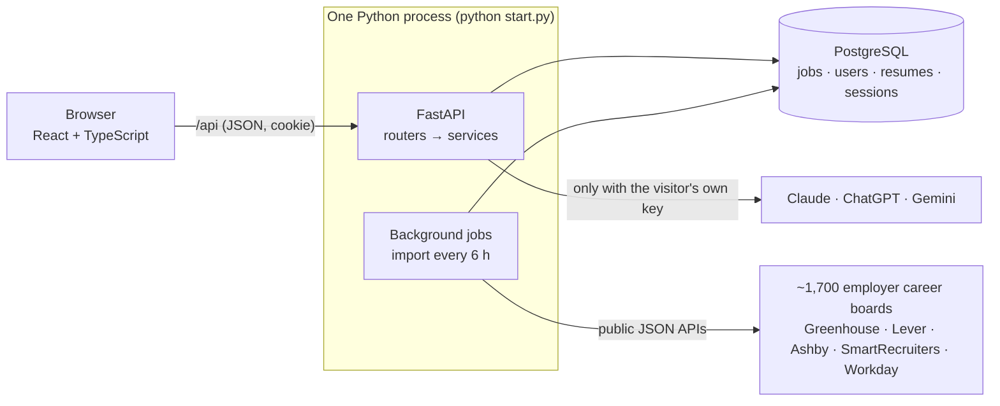

# How CoopRadar works (and how to explain it)

This guide is for the person who built CoopRadar: what every technology does and why it's there, what happens
step by step when someone uses the site, and how to talk about it with an employer or in an interview.

> Using the site: [Using CoopRadar](../using-coopradar/README.md) · Every module in depth:
> [docs/PROJECT_GUIDE.md](../../docs/PROJECT_GUIDE.md) · Hosting details: [docs/DEPLOY.md](../../docs/DEPLOY.md)

- [1. The short version](#1-the-short-version)
- [2. The tech stack, one piece at a time](#2-the-tech-stack-one-piece-at-a-time)
- [3. How the parts fit together](#3-how-the-parts-fit-together)
- [4. What happens, step by step](#4-what-happens-step-by-step)
- [5. The database](#5-the-database)
- [6. How it's tested](#6-how-its-tested)
- [7. How it's hosted for free](#7-how-its-hosted-for-free)
- [8. How to explain it](#8-how-to-explain-it)
- [9. Interview questions and answers](#9-interview-questions-and-answers)
- [10. Where to change things](#10-where-to-change-things)
- [11. Words you'll hear](#11-words-youll-hear)

---

## 1. The short version

CoopRadar is a full-stack job site for co-op students. A background importer pulls real jobs from about 170
employers' public career-board APIs (Greenhouse, Lever, Ashby, SmartRecruiters, Workday) into PostgreSQL: every job in
Canada, plus US internships. While importing, it reads each job description for the programs of study and
graduation years it asks for. A student uploads a resume (no sign-up); the app reads their program, degree and
graduation year from it, then ranks open jobs in SQL by skills, student fit, program, graduation year and co-op
term, and explains each match in plain words. An optional bring-your-own-key AI layer (Claude, ChatGPT or Gemini)
adds resume reviews, tailoring and cover letters.

**Stack in one line:** React + TypeScript (Vite, Tailwind, TanStack) on a Python FastAPI backend with PostgreSQL,
SQLAlchemy and Alembic, tested with pytest, Vitest and Playwright, run by one `python start.py`, hosted free on
Render + Neon, with GitHub Actions for CI.

---

## 2. The tech stack, one piece at a time

For each piece: what it is, why it's here, and where to find it. If an interviewer points at any line of the
README, this table is your answer.

### Frontend (what runs in the browser)

| Technology | What it is | Why CoopRadar uses it | Where |
|---|---|---|---|
| **React 18** | A library for building UIs out of components | Each part of the page (job row, postmark, filter panel, match) is a reusable component | `frontend/src/components/`, `pages/` |
| **TypeScript** | JavaScript with types | Catches mistakes before the browser does; the API's types are generated from the backend, so frontend and backend can't drift apart | everywhere in `frontend/src/` |
| **Vite** | Build tool and dev server | Instant reloads while developing; builds the optimized site for production | `vite.config.ts` |
| **Tailwind CSS** | Utility CSS classes (`px-4`, `text-sm`) | Fast, consistent styling. The palette, square corners and font live in one config, and shared pieces like `btn-primary`, `field` and `chip` live in one CSS file | `tailwind.config.ts`, `src/index.css` |
| **TanStack Query** | Data fetching and caching | Loads jobs, matches and filters, caches them, and refreshes after changes (e.g. after uploading a resume) | `frontend/src/api/*.ts` |
| **TanStack Table** | Headless table logic | The sortable table view of jobs | `components/PostingsTable.tsx` |
| **React Router** | Pages and URLs in a single-page app | `/`, `/resume`, `/postings/:id`, `/saved`...; all job filters live in the URL so searches are shareable | `App.tsx`, `pages/PostingsListPage.tsx` |
| **dnd-kit** | Drag and drop | Dragging jobs between columns on the tracker board | `components/TrackerBoard.tsx` |
| **openapi-typescript** | Generates TypeScript types from the API's OpenAPI schema | One source of truth for data shapes; CI fails if they're out of date | `src/api/types.gen.ts` |

### The look

The design borrows from a Canadian post office instead of the usual blue and grey job board. A postal red top bar,
airmail blue for links and anything picked, white rows split by thin ink lines instead of rounded cards, and
narrow capital labels like the ones on a customs form. The font is Archivo, which has a condensed width for
headings and labels and a normal width for reading.

The one signature piece is the **postmark**: a round, slightly tilted stamp on every job showing the city and the
day it was posted, the way a real postmark shows the town and day a letter was mailed. When you pick a job its
postmark turns red and lands like a stamp (switched off for people who ask for reduced motion). Match scores use
the same round stamp. The details panel draws the time left to apply as a bar to scale.

It was designed with the Impeccable design skill (`.claude/skills/impeccable/`). The product facts it worked from
are in `PRODUCT.md` and the finished design system is written down in `DESIGN.md`.

| Piece | Where |
|---|---|
| Colours, corners, shadows, font | `frontend/tailwind.config.ts` |
| Shared buttons, fields, chips, labels, focus ring, text selection | `frontend/src/index.css` |
| The postmark | `frontend/src/components/Postmark.tsx`, `postal.ts` |

### Backend (the server)

| Technology | What it is | Why | Where |
|---|---|---|---|
| **Python 3.12** | The backend language | Great libraries for web APIs, PDFs/Word files and AI SDKs | `backend/` |
| **FastAPI** | A modern async web framework | Fast, async, and it writes the API docs (`/docs`) and OpenAPI schema from the code | `backend/app/api/` |
| **Pydantic v2** | Data validation | Every request and response has a schema; bad input becomes a clean 422 error | `backend/app/schemas/` |
| **SQLAlchemy 2.0** (async) | The database toolkit / ORM | Typed models and safe, composable SQL queries (every filter is a bound parameter, never string-built SQL) | `backend/app/models/`, `services/` |
| **asyncpg** | Postgres driver | Fast async connection to the database | used by SQLAlchemy |
| **Alembic** | Database migrations | Every schema change is a numbered, reversible script (0001 to 0013) | `backend/alembic/versions/` |
| **httpx** | Async HTTP client | Calls the employers' career-board APIs | `backend/app/ingest/boards.py` |
| **asyncio background jobs** | Python's built-in concurrency | Runs the importer every 6 hours inside the web server, so there's no separate worker to host | `backend/app/jobs.py` |
| **argon2** | Password hashing | The current recommended way to store passwords | `backend/app/services/auth.py` |
| **pypdf, python-docx** | Read PDF and Word files | Pull the text out of uploaded resumes | `backend/app/services/resume.py` |
| **Anthropic, OpenAI, Google GenAI SDKs** | Official AI clients | Bring-your-own-key AI for Claude, ChatGPT or Gemini, behind one small module | `backend/app/ai.py` |

### Data

| Technology | What it is | Why |
|---|---|---|
| **PostgreSQL 16** | The database | It doesn't just store data, it does the work: full-text search (`tsvector` + GIN index), array overlap for skills and programs, regex on job titles, JSON columns |
| **pgvector** | Vector search extension | Optional "smart search" by meaning when an OpenAI key is set |
| **pgserver** | Postgres packaged as a Python library | `python start.py` runs a real Postgres on your computer with nothing to install |

### Quality and delivery

| Technology | What it does here |
|---|---|
| **pytest** (+ pytest-asyncio, respx) | Backend tests, with every external API mocked, including a speed test on 10,000 jobs |
| **Vitest + Testing Library** | Frontend component tests (filters, job cards, resume page) |
| **Playwright** | End-to-end tests: a real browser clicks through the running site (search, filters, upload a resume, phone layout) |
| **ruff, mypy --strict, ESLint, tsc** | Linting and type checking on both sides |
| **GitHub Actions** | CI on every push (all of the above, plus starting the real site and testing it), and a scheduled job that keeps the free hosted site's jobs fresh |
| **Render** | Hosts the web server (free plan) |
| **Neon** | Hosts the Postgres database (free plan, doesn't expire) |
| **Vercel** (optional) | Serves the pages from a CDN and forwards `/api` to Render |

> **Why not more frameworks?** Each one here does a job you can point to. Interviewers tend to ask "why did you
> use X?", and "to have more logos" isn't a good answer. If you add something later, add it because a feature
> needs it.

---

## 3. How the parts fit together

The backend has four layers, the same for every feature:

| Layer | Folder | Job | Example |
|---|---|---|---|
| Router | `app/api/` | The URL, who's logged in, hand off | `api/postings.py`: `GET /api/postings` |
| Schema | `app/schemas/` | Validate what comes in and goes out | `schemas/posting.py`: `PostingListParams` |
| Service | `app/services/` | The logic and the SQL | `services/postings.py`: `list_postings()` |
| Model | `app/models/` | A database table | `models/posting.py`: `Posting` |

---

## 4. What happens, step by step

### 4.1 Jobs come in (the importer)
Files: `app/ingest/boards.py`, `app/ingest/runner.py`, list of employers in `backend/seed/job_boards.py`.
1. On start-up and every 6 hours, the scheduler imports each employer's board, one at a time.
2. An **adapter** per job-board system downloads the company's public job list. These APIs exist so companies'
   jobs can be shown on other sites: no keys, no scraping, and every job links back to the employer.
   - Greenhouse: the list first, then descriptions only for the jobs we keep (one board, SpaceX, is 30 MB with
     every description, too much for a free server's memory).
   - SmartRecruiters: pages of 100 job summaries, then each kept job's description.
3. **Which jobs are kept** (`choose_location`): every job in Canada; in the US, only co-op, intern, student and
   new-grad roles (setting `INGEST_US_JOBS`). "Vancouver, WA" is recognized as the US, and "London" (UK) is never
   mistaken for London, Ontario.
4. **Location parsing**: "Hybrid - New York" becomes New York, NY; "SEA, SF, NY, Toronto" becomes Toronto, ON.
5. **What the description asks for** (`app/services/education.py`): sentences that mention a degree ("pursuing a
   Bachelor's in Computer Science, Engineering or a related field") are scanned for fields of study, and text after
   "graduating" or "class of" for years ("graduating in December 2027 or spring 2028" gives 2027 and 2028). These
   are stored on the job as `fields_of_study` and `grad_years`.
6. Skills are tagged from a 106-skill list, duplicates are skipped, jobs that disappeared are closed, and a board
   that fails three times in a row pauses itself.

### 4.2 Browsing jobs
`GET /api/postings` builds **one SQL query** from the filters (job type, level, country, program, graduation
year, location, work mode, date, term, length, company, skills), then sorts and pages it in the database. Job
types ("Software & web", "Data & AI"...) are regexes on the job title (`services/categories.py`). The page keeps
every filter in the URL, shows a details panel next to the list on wide screens, and shows the role (Co-op,
Internship, New grad), computed from the title on the server.

### 4.3 Uploading a resume
No account? The page first creates a **temporary account** (7 days, rate-limited per network) with a normal
session cookie. The file's text is extracted (pypdf / python-docx); only the text is kept.

### 4.4 Reading the student's education
`detect_education()` looks at resume lines about school (university, degree, "expected graduation") and finds:
- the **program** ("Mechatronics Engineering" is Mechanical / Mechatronics Engineering; specific programs are
  checked before general ones, so "Software Engineering" wins over plain "Engineering"),
- the **degree** (diploma, bachelor's, master's, PhD),
- the **graduation year** ("Expected graduation: April 2028", or the end of "Sept 2024 - Apr 2028").

Anything the student picked themselves wins; blanks are filled from the resume.

### 4.5 Matching (free, in SQL, no AI)
`app/services/resume.py`:
1. **Filters**: only open jobs that fit the student. Job types are the ones they picked or, if none, the ones
   their program leads to (Business leads to business, product and marketing roles). Countries, location (remote
   always counts), work mode, level, and graduation year: a job asking for a *different* year is dropped; jobs that
   don't say stay in.
2. **Score** (out of 100), all in one SQL expression:

   | Part | Points |
   |---|---|
   | Share of the job's skills on the resume (at least 3 in the denominator; senior titles count half) | 65 |
   | Co-op, intern, student or new-grad title | 15 |
   | The description names the student's field of study | 10 |
   | It names their graduation year | 5 |
   | It's for the co-op term they want | 5 |
   | Matches the keywords they typed | +20 |

   Only a job that fits on every count reaches 100.
3. **Why it fits**: each match gets plain reasons built from the same data: "Internship", "Asks for Computer
   Science / Software, which fits your program", "For students graduating in 2028, like you", "Summer 2027 term,
   the one you want", "For students still in school", "4 of 5 listed skills on your resume".
4. The top 20 are stored. With the student's AI key, **Re-rank with my AI** sends the ~40 best to their AI to
   re-score; invented job IDs are dropped and it falls back to the free ranking if the reply is unusable.

### 4.6 The AI extras (bring your own key)
The key stays in the browser and is sent as headers only on AI requests. `app/ai.py` wraps the three official SDKs
behind `complete()` and `stream()`. Prompts treat the resume and posting as data, never invent experience, and
cite their sources. Tailoring and cover letters stream word by word (Server-Sent Events).

---

## 5. The database

| Table | Holds |
|---|---|
| `postings` | every job: title, company, location, country, work mode, term, skills, `fields_of_study`, `grad_years`, a weighted full-text index |
| `ingest_sources` / `ingest_runs` | the ~1,700 career boards and feeds and a log of each import |
| `skills` | the skill list and aliases |
| `users` | accounts (argon2 hash, admin and temporary flags) |
| `resumes` | resume text, the student's preferences (JSON), the cached AI review |
| `match_results` | each resume's scored matches |
| `saved_postings` / `application_events` | the tracker and its history |
| `kv_store` | login sessions and rate-limit counters |
| `posting_embeddings` | optional vectors for smart search |

About 2,800 open jobs take roughly 50 MB, so the free 0.5 GB database has plenty of room.

---

## 6. How it's tested

- **Backend: about 290 pytest tests.** Every API endpoint, the importers (with recorded API responses, never the
  real internet), education reading, matching and scoring, a check that `vercel.json` forwards `/api` with its
  path, and a speed test: p95 under 300 ms on 10,000 jobs.
- **Frontend: 45 Vitest tests** for the filters, job list, resume page and date handling.
- **End-to-end: 7 Playwright tests** that open the real site in a browser: search, quick filters, the All filters
  panel, the details panel, uploading a resume and seeing "We read your resume: Computer Science...", and the phone
  layout.
- **CI** (`.github/workflows/ci.yml`) runs on every push: lint, types, migrations up, down and up again, a check
  that the models match the migrations, all tests, then builds and starts the real site exactly like the host does
  and runs the smoke and Playwright tests against it.

---

## 7. How it's hosted for free

| Piece | Free service | Why |
|---|---|---|
| Web server (API + pages) | **Render** free web service | Runs Python with no Docker; `render.yaml` sets it up |
| Database | **Neon** free Postgres | Doesn't expire (Render's free database is deleted after 30 days); 0.5 GB is ~10x what's needed; includes pgvector |
| Keeping jobs fresh | **GitHub Actions** (`refresh-jobs.yml`) | Render's free plan sleeps after ~15 idle minutes, and the importer only runs while awake. A scheduled workflow wakes it every 6 hours |
| Optional nicer address | **Vercel** (`vercel.json`) | Serves the pages fast from a CDN and forwards `/api` to Render |

Why not Vercel alone? Vercel runs code only for a moment per request, but CoopRadar needs a server that keeps
running to import jobs on a schedule, and a database. Step-by-step setup is in the
[README](../../README.md#host-it-for-free).

One thing to get right: the `/api` line in `vercel.json` has to end with `/api/:path*`, for example
`https://your-site.onrender.com/api/:path*`. Without that ending every request lands on the Render home page,
gets a web page back instead of job data, and the site says the jobs didn't load. A backend test checks this.

---

## 8. How to explain it

### 30 seconds (to a student)
> "Upload your resume and CoopRadar shows you the co-op jobs you're actually a fit for. It reads your program and
> graduation year from your resume, checks what each job description asks for, and tells you why each job fits and
> which skills you're missing. About 2,800 real jobs from 120 employers, refreshed every few hours. Free, no
> sign-up."

### 30 seconds (to an engineer or employer)
> "It's a full-stack app: React and TypeScript on FastAPI and PostgreSQL. A background importer pulls jobs from
> about 170 employers' public job-board APIs every six hours and extracts structured data from the descriptions,
> like the programs and graduation years each job wants. Matching runs entirely in SQL: one query filters and scores
> every open job by skill coverage, student fit, program, graduation year and term, and the app explains each
> match. There's an optional bring-your-own-key AI layer. It's one command to run locally, hosted free on Render and
> Neon, and CI runs about 340 tests including Playwright in a real browser."

### 2 minutes (follow the data)
1. **Data in.** Adapters for four applicant-tracking systems, with location rules (Canada; US internships only) and
   memory-aware fetching. Descriptions are parsed for fields of study and graduation years.
2. **Search.** Every filter is a SQL clause; the frontend keeps them in the URL; the job board layout shows the list
   and the details side by side.
3. **Resume in.** No sign-up: a temporary account. Education is read from the resume.
4. **Matching.** One SQL query: filters, a weighted score, top 20, with plain "why it fits" reasons. No AI needed,
   so it's free and instant.
5. **AI, optional.** The visitor's own key; prompts treat documents as data; results are validated and streamed.
6. **Quality.** Strict types on both sides, about 340 tests, CI that boots the real site, free hosting with a
   scheduled job to keep it fresh.

### What you can say you learned
- Designing a data pipeline around real, messy external data (locations, missing deadlines, duplicates, huge
  payloads).
- Doing the heavy lifting in the database instead of in Python or the browser.
- Building explainable ranking before reaching for AI, and using AI as an optional layer.
- Testing at three levels (unit, API, end-to-end) and automating it in CI.
- Shipping on free infrastructure and working around its limits.

---

## 9. Interview questions and answers

| Question | Answer |
|---|---|
| *Where do the jobs come from? Is it scraping?* | No. Greenhouse, Lever, Ashby, SmartRecruiters and Workday publish public JSON APIs so companies' jobs can be shown elsewhere. No logins, no HTML scraping, and every job links to the employer to apply. |
| *How do you know a job wants Computer Science students?* | At import, the description is split into sentences; only sentences mentioning a degree ("pursuing a Bachelor's in...") are checked for fields of study, so "our engineering team" doesn't count but "a degree in Engineering" does. Stored as an array and matched with Postgres array overlap. |
| *How is the graduation year used?* | Read from the resume, or set by the student. Jobs naming their year get points and a "like you" note. Jobs naming a different year stay in but rank lower with a "check before you apply" note, since students apply widely. Jobs that don't say are kept. |
| *Why not LinkedIn, Indeed or Glassdoor?* | Their terms forbid automated collection and most of their listings are reposts of jobs on employers' own career sites. CoopRadar reads those career sites directly (Greenhouse, Lever, Ashby, SmartRecruiters and Workday cover most big employers in every field), plus Workable's public job search and boards found through Common Crawl's free URL index, which bring in thousands of small employers. |
| *How do you know the term and length?* | `app/ingest/terms.py` reads them with plain rules: "Summer 2027", "Fall '27", "S27", "(January 2027)" in a title, "May to August", "4 month co-op", "12 week internship", "one year contract". Lengths round to the usual co-op lengths. Months next to "experience" or "graduation" are ignored. Postgres turns the term into a season and a start date with generated columns so filters and sorts stay in SQL. |
| *Why match in SQL before AI?* | SQL scores every open job in one query, instantly and for free, and works for users without a key. AI is slower and costs money, so it only re-ranks a 40-job shortlist when the user asks. |
| *Why are the weights 65 / 15 / 10 / 5 / 5?* | Skills matter most, but a student should see co-op roles and roles for their program above a senior job they happen to match. Earlier versions added bonuses on top and too many jobs hit 100, which made scores meaningless; now only a job that fits on every count reaches 100. There are tests pinning the numbers. |
| *Why include US jobs?* | Many Canadian co-op students do a US term. Only student roles are imported from the US (configurable), so the database stays small and focused. |
| *A board's API returned 30 MB. What did you do?* | For Greenhouse I switched to fetching the list without descriptions, filtering it, then fetching descriptions only for kept jobs, a few at a time. Memory stays low on a 512 MB free server. |
| *What if a job board changes or goes down?* | Only that source fails. The run is logged, it pauses itself after three failures, and the others keep working. Adapters are tested against recorded responses. |
| *How does "no sign-up" stay safe?* | A temporary account with a random password nobody knows, a normal HTTP-only session cookie, a rate limit per network, deleted after 7 days unless the user adds an email and password. |
| *How do you stop the AI making things up?* | Context-only prompts, required citations or an exact "not enough information" answer, never inventing experience, discarding job IDs it invents, and treating resume and posting text as data, not instructions. |
| *How would it scale?* | Search and matching are indexed SQL (p95 under 300 ms on 10,000 jobs in CI). AI costs sit with users. The importer could move to a separate worker and sessions to Redis by setting `REDIS_URL`. |
| *What would you do next?* | Email alerts for new matches, more employers (including school job boards with public feeds), and a learning-to-rank step using which jobs students save. |

---

## 10. Where to change things

| I want to change... | Look in |
|---|---|
| Which employers are imported | `backend/seed/job_boards.py` |
| Canada-only, or which US jobs | `INGEST_LOCATION_FILTER`, `INGEST_US_JOBS` (`backend/app/config.py`) |
| Programs, fields of study, graduation year rules | `backend/app/services/education.py` |
| Job types and their title patterns | `backend/app/services/categories.py` |
| Match scoring weights and "why it fits" | `backend/app/services/resume.py` (`_W_*`, `fit_notes`) |
| The jobs page layout | `frontend/src/pages/PostingsListPage.tsx`, `components/PostingCard.tsx`, `PostingDetailView.tsx` |
| The postmark stamp | `frontend/src/components/Postmark.tsx` |
| Filters | `frontend/src/components/FilterBar.tsx`, `filters.ts` |
| The resume page | `frontend/src/pages/ResumePage.tsx` |
| Colours and font | `frontend/tailwind.config.ts` (and `DESIGN.md` for the reasons) |
| Buttons, fields and chips everywhere | `frontend/src/index.css` |
| AI prompts | `backend/app/agent/resume_qa.py`, `backend/app/services/insights.py` |
| A database table | `backend/app/models/` plus a migration (`/db-migration` skill) |
| Hosting | `render.yaml`, `vercel.json`, `.github/workflows/refresh-jobs.yml` |

---

## 11. Words you'll hear

| Word | Meaning |
|---|---|
| **API** | The part of the server the website talks to (`/api/...`), sending and receiving JSON |
| **Endpoint** | One URL of the API, like `GET /api/postings` |
| **ORM** | Code that maps database tables to Python classes (SQLAlchemy here) |
| **Migration** | A versioned script that changes the database structure |
| **Full-text search** | Searching words in text with ranking, done by Postgres |
| **Adapter** | Code that turns one external API's format into ours |
| **CI** | Continuous integration: GitHub runs every check on every push |
| **End-to-end test** | A test that uses the site like a person would, in a real browser |
| **SPA** | Single-page app: the browser loads the site once, then React swaps the pages |
| **CDN** | Servers around the world that deliver the website's files quickly |
| **Cold start** | The wait while a sleeping free server wakes up |
