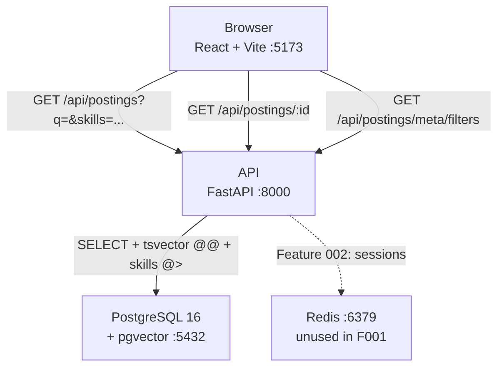

# Implementation Plan: Browse & Search Postings

**Branch**: `001-browse-search-postings` | **Date**: 2026-10-09 | **Spec**: [spec.md](spec.md)

**Input**: Feature specification from `specs/001-browse-search-postings/spec.md`

---

## Summary

Students need a single place to browse, search, and filter co-op postings. The feature delivers
a paginated, server-side-sorted and filtered postings table backed by a FastAPI + PostgreSQL API,
with a React/TypeScript frontend. All query state lives in the URL. ~60 realistic seed postings
cover 8 cities and 3 co-op terms. A performance test validates the 300 ms p95 budget against
10,000 generated postings.

---

## Technical Context

**Language/Version**: Python 3.12 (backend), TypeScript 5.x / Node 20+ (frontend)

**Primary Dependencies**:
- Backend: FastAPI 0.115+, Pydantic v2, SQLAlchemy 2.0 async, Alembic, httpx, pytest, pytest-asyncio
- Frontend: React 18, Vite 6, TanStack Query v5, TanStack Table v8, Tailwind CSS v3, React Router v6, Vitest, Testing Library

**Storage**: PostgreSQL 16 with `pgvector` extension (installed for future use). Redis in stack (unused in this feature; present for Feature 002).

**Testing**: pytest + pytest-asyncio (backend); Vitest + Testing Library (frontend)

**Target Platform**: Linux containers via Docker Compose; services: `db`, `redis`, `api`, `web`

**Project Type**: Full-stack web application — REST JSON API + React SPA

**Performance Goals**: `GET /api/postings` p95 ≤ 300 ms on 10,000 postings; page load ≤ 2s

**Constraints**:
- All filtering/sorting/pagination in SQL (Constitution II); no raw string SQL
- sort/filter column whitelist server-side; unknown value → 422 (api-conventions skill)
- Skills stored as `TEXT[]` with GIN index; duration as `SMALLINT` CHECK IN (4,8,12,16)

**Scale/Scope**: ~60 seed postings for dev; architecture validated at 10,000 rows in perf test

---

## Constitution Check

| Principle | Status | Notes |
|-----------|--------|-------|
| I. Correctness First | PASS | Pydantic schemas on all endpoints; pytest covers happy-path + validation |
| II. Data in DB Layer | PASS | All sort/filter/pagination via SQLAlchemy; whitelist in service; no raw SQL |
| III. Performance Budgets | PASS | GIN + B-tree indexes; perf test asserts p95 ≤ 300 ms at 10k rows |
| IV. Honest AI | N/A | No AI in this feature |
| V. Privacy & Security | PASS | No personal data; no auth; no secrets committed |
| VI. Responsible Data | PASS | Seed data only; no scraping |
| VII. Accessible UI | PASS | Tailwind mobile-first; keyboard nav; 375 px; WCAG AA target |
| VIII. Small Changes | PASS | Single branch; conventional commits; agentic-workflow.md updated post-feature |
| IX. Simplicity | PASS | All dependencies listed below with stated reasons |

All applicable gates **PASS**. No violations.

---

## Dependency Rationale (Constitution IX)

| Package | Side | Reason |
|---------|------|--------|
| FastAPI | Backend | Standard async Python web framework; OpenAPI generation built-in |
| Pydantic v2 | Backend | Request/response validation; required by FastAPI |
| SQLAlchemy 2.0 async | Backend | ORM with async support; typed queries; Constitution II compliance |
| Alembic | Backend | Database migrations paired with SQLAlchemy |
| httpx | Backend | Async HTTP client for perf test; used in future ingestion |
| pytest-asyncio | Backend | Required to test async FastAPI routes |
| TanStack Query v5 | Frontend | Server-state fetching with caching; frontend-tables skill requirement |
| TanStack Table v8 | Frontend | manual sort/filter/pagination mode; frontend-tables skill requirement |
| React Router v6 | Frontend | URL state management via useSearchParams |
| openapi-typescript | Frontend | Type generation from FastAPI OpenAPI schema; frontend-tables skill requirement |
| Tailwind CSS v3 | Frontend | Utility-first CSS; mobile-first; frontend-tables skill requirement |
| Vitest + Testing Library | Frontend | Vite-native test runner; frontend-tables skill requirement |

---

## Project Structure

### Documentation (this feature)

```text
specs/001-browse-search-postings/
├── plan.md              # This file
├── research.md          # Phase 0 decisions
├── data-model.md        # Posting entity, indexes, SQLAlchemy reference
├── quickstart.md        # End-to-end validation guide
├── contracts/
│   └── api.md           # REST endpoint contracts + Pydantic schemas
└── tasks.md             # Generated by /speckit-tasks (next step)
```

### Source Code (repository root)

```text
backend/
├── app/
│   ├── main.py                        # FastAPI app factory, CORS, router mount
│   ├── db.py                          # Async engine + session factory
│   ├── models/
│   │   └── posting.py                 # Posting model + WorkMode enum
│   ├── schemas/
│   │   └── posting.py                 # PostingListItem, PostingDetail, PostingsPage, FilterMeta
│   ├── services/
│   │   └── postings.py                # list_postings, get_posting, get_filter_meta
│   └── api/
│       └── postings.py                # FastAPI router (thin)
├── alembic/
│   ├── env.py
│   └── versions/
│       └── 0001_create_postings.py    # CREATE TABLE + indexes + tsvector trigger
├── seed/
│   └── __init__.py                    # 60 realistic postings; run: python -m seed
├── tests/
│   ├── conftest.py                    # Async test DB fixture
│   ├── api/
│   │   └── test_postings.py           # Happy-path + validation per endpoint
│   └── perf/
│       └── test_perf.py               # p95 ≤ 300 ms at 10,000 rows (pytest -m perf)
├── pyproject.toml
└── Dockerfile

frontend/
├── src/
│   ├── api/
│   │   ├── types.gen.ts               # openapi-typescript output (npm run gen:api)
│   │   └── postings.ts                # usePostings, usePosting, useFilterMeta hooks
│   ├── components/
│   │   ├── PostingsTable.tsx          # TanStack Table manual mode
│   │   ├── FilterBar.tsx              # All filter controls
│   │   ├── SearchBox.tsx              # Debounced 300 ms input
│   │   └── PostingCard.tsx            # Mobile card (<md)
│   ├── pages/
│   │   ├── PostingsListPage.tsx       # Owns URL state; composes table + filters
│   │   └── PostingDetailPage.tsx      # Full detail view
│   └── main.tsx
├── tests/
│   ├── PostingsTable.test.tsx
│   └── FilterBar.test.tsx
├── package.json
├── vite.config.ts
├── tailwind.config.ts
└── Dockerfile

docker-compose.yml
.github/workflows/ci.yml
README.md                              # Mermaid architecture diagram
```

**Structure Decision**: Web-app option. Python and TypeScript require separate toolchains,
dependency managers, and Docker images. Top-level `backend/` + `frontend/` is the standard
full-stack monorepo layout; CI matrix jobs map directly to these two directories.

---

## Architecture Diagram (README Mermaid)



---

## Phase 0 Research Summary

See [research.md](research.md). Key decisions:

| Topic | Decision |
|-------|----------|
| Keyword search | `tsvector` GENERATED column + GIN index; weights A/B/C; `websearch_to_tsquery` |
| Skills filter | `TEXT[]` + GIN; `@>` for AND-logic |
| Duration filter | 4 checkboxes (4/8/12/16 mo); OR'd in SQL with `IN` |
| API types | `openapi-typescript` v7; `npm run gen:api` |
| URL state | React Router v6 `useSearchParams` |
| Perf validation | `pytest -m perf`; 50 concurrent httpx requests; p95 assertion |
| Layout | `backend/` + `frontend/` monorepo |

---

## Phase 1 Design Artifacts

- [data-model.md](data-model.md) — `postings` table schema, `work_mode_enum`, all 11 indexes, SQLAlchemy model reference
- [contracts/api.md](contracts/api.md) — `GET /api/postings`, `GET /api/postings/{id}`, `GET /api/postings/meta/filters` with full request/response shapes and Pydantic schemas
- [quickstart.md](quickstart.md) — prerequisites, stack startup, curl validation, frontend smoke tests, automated test commands

---

## Post-Phase-1 Constitution Re-check

All gates confirmed **PASS** after design:
- Every sortable/filterable column has an index (Constitution III, api-conventions skill)
- `search_vector` GENERATED ALWAYS column keeps GIN index consistent automatically
- `PostingListParams` uses `Literal` for `sort` — unknown values produce 422 at Pydantic layer before reaching the service
- No constitution violations introduced in design

---

## Complexity Tracking

> No violations — no entries required.

---

## Notes

- `tasks.md` is generated by `/speckit-tasks` — not part of this plan.
- The `pgvector` extension is installed at DB init but unused in this feature. It must be present for Feature 003 vector columns.
- Redis is in the Compose stack but not used by Feature 001. Present so Feature 002 (auth) can be added without a stack change.
- `GENERATED ALWAYS AS … STORED` for `search_vector` requires PostgreSQL 12+; the stack uses PG 16.
